# サーバー（apps/server）

アプリが判定した結果と、走行後の生データを受けて保存する API。今は**ローカルだけ**で、AWS へのデプロイ・地図・ログインは作っていない。
- 経緯と決定：[`docs/knowledge/2026-11-18/20261118_local_server_plan.md`](../../docs/knowledge/2026-11-18/20261118_local_server_plan.md)
- Kotlin に移した理由：[`docs/knowledge/2026-11-18/20261118_server_kotlin_snapstart.md`](../../docs/knowledge/2026-11-18/20261118_server_kotlin_snapstart.md)

- **API**：Kotlin + [http4k](https://www.http4k.org)。同じコードを、PC では普通のサーバー（Jetty）で、本番では Lambda の入口（`LambdaHandler`、java21・SnapStart）で動かす
- **DB**：PostgreSQL。`migrations` の `.sql` を名前順に流す
- **生データ**：S3 互換のストレージに、**署名付き URL で直接 PUT** する（API は通さない）。ローカルでは SeaweedFS を使う
- **TypeScript 版**：[`apps/server-ts`](../server-ts/README.md) に凍結して残している（研究室のサーバーに JVM を置けない場合の予備）。API の形も DB も同じだが、新しい API は足さない

## 構成



**上段**は、**いまの構成**（ローカルで動作確認済み）です。**下段**は、**本番の AWS**（未構築）です。

左のアプリは同じものです。サーバーの入口・DB・ストレージを、ローカルの部品から AWS のサービスに入れ替えます。

矢印の番号は送る順番です。
- ①は走行中に何度も送ります。
- ②③④は走行を止めたあとに送ります。
- ③だけは API を通りません。アプリが署名付き URL で、ストレージへ直接送ります。Lambda は 6 MB を超えるデータを受け取れず、生データは 50〜160 MB あるためです。

| 項目 | いま（ローカル） | 本番（AWS・計画） | 理由 |
| --- | --- | --- | --- |
| API | Kotlin + http4k を JVM で動かす（`./gradlew run`） | API Gateway（HTTP API）+ Lambda（java21、SnapStart）。同じコードを `LambdaHandler` で動かす | アプリと同じ言語にそろえる。前に Kotlin を外した理由（Lambda の起動の遅さ）は、SnapStart で補う。Java では SnapStart に追加料金がかからない |
| DB | PostgreSQL（Docker） | RDS など（未選定） | 地図で範囲を検索し、同じ場所を何度も通ったときの集計をするのに、SQL が素直 |
| 生データの置き場 | SeaweedFS（Docker。S3 の API） | Amazon S3 | S3 の API だけを使うので、そのまま入れ替えられる |
| 生データの送り方 | 署名付き URL で、アプリから直接 PUT | 同じ | API は URL の発行と完了の確認だけをする |
| 判定結果の送り方 | 5 秒ごとにまとめて POST。失敗したら端末に残して再送 | 同じ | `(走行 ID, 窓の始まり)` で重複を弾くので、再送しても二重にならない |
| 認証 | 共有キー（`x-api-key`） | 同じ（HTTPS にする） | 研究室の中だけで使う前提 |
| 見送ったもの | AWS Emulator、MinIO | - | [経緯](../../docs/knowledge/2026-11-18/20261118_local_server_plan.md) |

ロゴつきの HTML（アーティファクト）にした同じ図は、[こちら](https://claude.ai/artifact/XbSptd7i6ffjLttfh6egR2) にあります（所有者だけが開けます）。

図は `docs/diagram/build.py` で作ります。
- コマンドは `python3 apps/server/docs/diagram/build.py` です。
- ロゴの素材は `docs/diagram/logos/` に置いています。
- ロゴは構成を示すためだけに使っています。AWS のアイコンは、色も形も変えていません。
- 出典は `build.py` の冒頭に書いています。

## 動かし方

必要なのは JDK 17 以上（Gradle を動かすため）と Docker です。JDK 21 が手元に無ければ、Gradle が `~/.gradle/jdks` に取ってきます（http4k 6 と Lambda の java21 に合わせるため）。Node.js は要りません。

```sh
cd apps/server
cp .env.example .env     # 開発用の値。.env は git に入れない
docker compose up -d --wait postgres s3   # PostgreSQL と S3 互換のストレージ（127.0.0.1 だけに公開）
./gradlew migrate        # 表を作る（サーバーの起動時にも流れる）
./gradlew run            # http://127.0.0.1:8787（.env を読む。すでにある環境変数が優先）
./gradlew test           # テスト（上の 2 つに実際につなぐ。専用のスキーマとバケットを使う）
./gradlew lambdaZip      # Lambda に上げる zip（build/distributions/roadml-server-lambda.zip）
docker compose down      # 止める（データは残る。消すなら docker compose down -v）
```

テストは 26 件あります。
- **`ApiTest`（15 件）**：TypeScript 版の結合テストと同じ項目です。
- **`LambdaHandlerTest`（3 件）**：API Gateway と同じ形のイベントを、Lambda の入口に入れて確かめます。
- **`SchemasTest`（8 件）**：入力の検証が TypeScript 版（Zod）と同じ規則になっていることを確かめます。

PC から記録済みの走行を送って、保存を確かめるには、TypeScript 版の送信スクリプトを使います。このスクリプトは API に HTTP で送るだけなので、Kotlin 版にも使えます。

```sh
cd apps/server-ts && npm install && cp .env.example .env
npm run send -- ../../wheelchair_data/11.1/20261101142339 ../../data/analysis/20261116_export_onnx/parity/20261101142339.csv
```

Android エミュレーターから送るときは、署名付き URL のホストを `10.0.2.2` にして起動する（`S3_PUBLIC_ENDPOINT=http://10.0.2.2:8333 ./gradlew run`）。アプリ側の手順は [`apps/detector-android/README.md`](../detector-android/README.md) の「サーバーへの送信」。

## API

認証は、ヘッダー `x-api-key`（共有キー。研究室内だけの前提で、強い認証ではない）。`/health` だけは鍵が要らない。

| メソッド・パス | 内容 |
| --- | --- |
| `POST /sessions` | 走行の登録。id（UUID）はアプリが作る。同じ id の再送は 200（冪等）、別の端末の同じ id は 409 |
| `POST /sessions/:id/detections` | 判定結果のバッチ（最大 2000 件）。`window_start_ms` はセンサーの時刻（アプリでは起動から。生データの `timestamp` と同じ基準）、`window_wall_ms` は壁時計（epoch ms）。`(走行 id, 窓の始まり)` で重複を弾く。`{received, inserted, duplicates}` を返す |
| `POST /sessions/:id/raw-upload-url` | 生データを PUT する署名付き URL を返す（有効 1 時間） |
| `POST /sessions/:id/raw-complete` | アップロードの完了通知。置かれたファイルの大きさが `size_bytes` と合わなければ 409 |
| `GET /health` | DB への疎通 |

- 判定のクラスは `flat`・`step`・`rough` です。モデルのクラス名 `dansa`・`dekobo` は、アプリが送る前に `step`・`rough` に置き換えます。
- `scores` は SVM の決定関数の値で、確率ではありません。
- 位置（`lat`・`lon`・`accuracy_m`）が取れなかった窓では、これらの項目を省きます。
- 間違った入力には 400 を返し、`issues` に項目の場所（`path`）と理由を並べます。

検証の規則は TypeScript 版（Zod）と同じです（`src/main/kotlin/roadml/server/Schemas.kt`）。
- 知らないキーは無視します。
- 任意の項目に `null` を入れると、間違いとして扱います。
- 整数は「小数部の無い数」で、範囲は ±2^53 − 1 です。

2026-11-18 に、両方の版のサーバーへ同じ 54 通りの入力を送って比べました。ステータスと返事は、すべて一致しました。

## Lambda に載せるとき（未実施）

AWS のアカウントができてから、次の設定で載せる。

- **ランタイム**：java21。ハンドラーは `roadml.server.LambdaHandler::handleRequest` にします。zip は `./gradlew lambdaZip` で作ります（約 18 MB。Jetty も入っていますが、Lambda では使いません）。
- **SnapStart**：`PublishedVersions` にします。SnapStart は、公開したバージョンと、それを指すエイリアスにしか効きません（`$LATEST` には効きません）。API Gateway は、エイリアスに向けます。
- **入口**：API Gateway の HTTP API で、ペイロードの形式は 2.0 です。http4k は応答の本文を base64 で返しますが、API Gateway が元に戻してクライアントへ返します。
- **環境変数**：`API_KEY`、`DATABASE_URL`、`S3_BUCKET` は必須です。`DB_POOL_SIZE` は 1〜2 にします（Lambda の実行環境ごとに、接続を持つため）。
  - `S3_ENDPOINT`・`S3_PUBLIC_ENDPOINT`・`S3_ACCESS_KEY`・`S3_SECRET_KEY` は付けません。付けなければ、本物の S3 と、Lambda の実行ロールの認証情報を使います。
- **マイグレーションとバケットの作成**：Lambda の中では行いません。デプロイの手順として、`./gradlew migrate` などを別に流します。

SnapStart のために、コードの側では次のようにしています（`LambdaHandler.kt`・`Db.kt`）。
- **スナップショットに入るもの**：初期化（`LambdaHandler` を作るとき）で作るのは、設定・S3 のクライアント・ルーティングまでです。
- **DB への接続**：PostgreSQL へは、リクエストを受けてから初めてつなぎます。初期化中に張った接続は、スナップショットから戻したあとに使えるとは限らないためです（[AWS のドキュメント](https://docs.aws.amazon.com/lambda/latest/dg/snapstart.html)）。
  - テストで、つながらない DB を指定しても入口を作れること、リクエストで初めて失敗することを確かめています。
- **一意の値・乱数**：初期化中には作りません。スナップショットから戻したすべての実行環境で、同じ値になってしまうためです。走行の id は、アプリが作ります。

## 注意

- **署名付き URL のホスト**：署名にはホストが入る。`S3_PUBLIC_ENDPOINT` を、クライアントから見える名前にする（PC は `127.0.0.1`、Android エミュレーターは `10.0.2.2`）。
- **チェックサム**：AWS SDK は、既定ではリクエストにチェックサムを付ける。S3 互換のストレージ（SeaweedFS）で失敗することがあるので、`WHEN_REQUIRED`（必要なときだけ）にしている（`Storage.kt`）。
- **MinIO は使わない**：コミュニティ版は、公式イメージの配布をやめ、リポジトリもアーカイブされた（2026-02）。
- **DB は TypeScript 版と共有できる**：同じ `migrations` と、同じ `schema_migrations` の表を使う。`compose.yaml` も同じなので、同じコンテナとデータを使う。
- ローカルで確かめていないこと：SnapStart での実際の起動時間、戻した直後の DB 接続の速さ、PostgreSQL への同時接続の数。本番に載せるときに確かめる。
