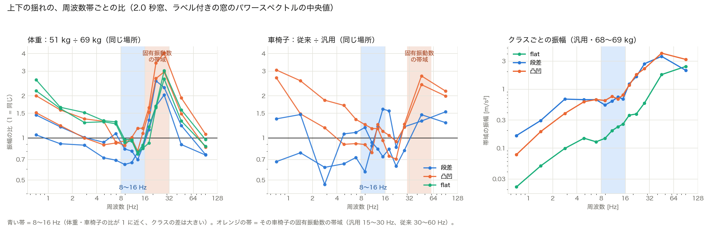

# 体重・車椅子によらない周波数帯の特徴量（固有振動数より下の帯域を使う）

これまでの補正（[平坦路を基準にした補正](../2026-10-31/20261031_speed_weight_normalization_survey.md)、[直前の走行との比・水増し](20261101_correction_eval.md)、[人ごとの平坦路の基準](20261101_person_calib.md)）は、どれも「揺れの大きさを 1 つの数で割る・何倍かする」方法で、決め手にならなかった。体重・車椅子による揺れの変わり方が、路面ごとに違う（flat は約 1.2 倍、凸凹は約 1.45〜1.75 倍）ためである。

ここでは、**周波数ごとに分けると、体重・車椅子によらない帯域がある**かを調べ、その帯域の揺れを特徴量にした。補正の基準（平坦路を走る、など）は要らない。

## まず全体の説明（ゼミ向け）

### 「周波数」とは

ここでいう周波数は、**センサーの周波数ではなく、揺れそのものの速さ**（1 秒間に何回上下に揺れるか）。10 Hz なら 1 秒に 10 回上下する揺れ。加速度センサーが 1 秒に約 330 回測っていること（サンプリング周波数）とは別の話で、330 回測っているから、1 秒に 100 回くらいの速い揺れまで見分けられる、という関係。

上下の揺れ（z）は 1 本の波形に見えるが、実際には速さの違う揺れが混ざっている（音楽で低音と高音が混ざって 1 つの音に聞こえるのと同じ）。フィルタ（イコライザーのようなもの）で、特定の速さの揺れだけを取り出せる。

```
センサーで測った上下の揺れ（z）
 ＝ ゆっくりした揺れ　（1 秒に 1〜8 回）  … 漕ぐ動き、体の揺れ（と考えている）
 ＋ 中くらいの揺れ　　（1 秒に 8〜16 回） … 路面の凸凹をそのまま拾った揺れ（と考えている）
 ＋ 速い揺れ　　　　　（1 秒に 15〜30 回）… 車椅子のフレームのブルブル（固有振動数）
```

それぞれの揺れの中身の根拠の強さは同じではない：

| 揺れ | 根拠 |
| --- | --- |
| 速い揺れ = フレームのブルブル | **データの裏付けあり**。平坦路の揺れの山が、汎用は 15〜30 Hz、従来は 30〜60 Hz で、車椅子を変えると動く（[形だけの補正](20261101_spectral_shape.md)）。体重の差もこの帯域に集中していた（1 章） |
| 中くらいの揺れ = 路面の凸凹 | **解釈**。体重・車椅子を変えてもほぼ同じで、路面の種類では 3〜4 倍違うことは測った（1 章）。「乗る人・車椅子によらず路面で決まる揺れ」なので路面の凸凹を拾っていると解釈し、振動の理屈（震えやすい速さより遅い揺れは地面の動きがそのまま伝わる）とも合う。路面の形そのものは測っていない |
| ゆっくりした揺れ = 漕ぐ動き・体の揺れ | **確かめていない想定**。体重・車椅子で比がばらつく（0.5〜3 倍）ことだけが分かっている。漕ぐのが 1 秒に 1 回くらいであること、座った人の体の揺れやすい速さが 4〜6 Hz と言われていること（5 章の関連研究）からの推測 |

8 と 16 という境目は、データ（1 章の比の表）を見て決めた。4〜8・4〜16 Hz にしても同じように効くので、境目が厳密に 8・16 である必要はなく、大事なのは固有振動数（15 Hz 以上）を含めないこと。

### これまでの補正がうまくいかなかった理由

これまでの補正は、どれも「揺れの大きさを 1 つの数で割る」方法だった。しかし体重による揺れの変わり方は、flat で約 1.2 倍、凸凹で約 1.5 倍と路面ごとに違い、1 つの数ではそろえられなかった。

### 何が分かったか

車椅子には、**ブルブル震えやすい速さ（固有振動数）**がある（汎用の車椅子で 1 秒に 15〜30 回）。同じ場所で 51 kg と 69 kg の人を比べると：

| 揺れの速さ | 51 kg ÷ 69 kg |
| --- | --- |
| ゆっくり（1〜8 回/秒） | 0.7〜2.6 倍（漕ぎ方などでばらつく） |
| **中くらい（8〜16 回/秒）** | **0.65〜1.17 倍（ほぼ同じ）** |
| 速い（15〜30 回/秒） | 最大 4 倍（軽い人はフレームがよく震える） |

- 体重の差は、ほとんど「速い揺れ（固有振動数の付近）」に出ていた。これまでの z_rms は全部の揺れをまとめて測っていたので、この差がそのまま入っていた。路面ごとに倍率が違ったのも、路面によって「速い揺れ」の混ざり方が違うため。
- **中くらいの揺れは、路面の凸凹をそのまま拾っているので、誰が乗ってもほぼ同じ**。それでいて、flat と凸凹の差（約 3〜4 倍）はしっかり出る。
- 理屈：「重り + ばね」の振動系では、震えやすい速さより遅い揺れは、乗っているものの重さによらず、地面の動きがそのまま伝わる（車の振動の分野の quarter-car モデルと同じ考え方）。
- 車椅子を変えた場合も同じで、従来の車椅子は震えやすい速さが 1 秒に 30〜60 回と速く、差はそこに集中していた。

### core5b とは

core5 の 5 つの特徴量のうち、上下の揺れから計算する 2 つを、**中くらいの揺れ（8〜16 回/秒）だけから計算する**ように変えたもの。計算の前にフィルタを 1 回かけるだけ。

| core5 | core5b |
| --- | --- |
| z_rms：全部の揺れの大きさ | **zb_rms：中くらいの揺れの大きさ** |
| z_kurt：全部の揺れの尖度 | **zb_kurt：中くらいの揺れの尖度** |
| tilt_range、g_low_high、g_over_z | （同じ） |

### 結果（SVM・2.0 秒、flat / step / rough）

| | 同じ人の中 | 軽い人で学習 → 重い人でテスト |
| --- | --- | --- |
| core5 | 0.95 / 0.95 / 0.94 | 0.92 / 0.98 / **0.89** |
| **core5b** | 0.96 / 0.95 / 0.93 | 0.92 / 0.95 / **0.97** |

- 体重が違っても当たるようになり（凸凹 0.89 → 0.97）、ふだんの精度は下がらない。
- 平坦路を走るなどの準備が要らない（フィルタをかけるだけ）。
- 帯域を 4〜8・4〜16 回/秒にしても同じように効き、震えやすい速さを含む 8〜32 回/秒にすると効かない。効いているのは「震えやすい速さの揺れを外したこと」。
- 残る課題：車椅子を変えたときにはまだ弱い（従来の車椅子の凸凹 0.54）。当面は汎用の車椅子だけを使うので困らない。

以下は、詳しい方法・数値・考察。

## サマリ

- **8〜16 Hz の上下の揺れは、体重でも車椅子でもほとんど変わらない**。同じ場所の組の振幅の比は、体重で 0.65〜1.17、車椅子で 0.57〜1.61（中央の 80% は 0.76〜1.25）。体重の差は 16〜32 Hz（汎用の車椅子の固有振動数の帯域）に、車椅子の差は 32 Hz 以上（従来の車椅子の固有振動数の帯域）に集中していた（1.3〜4 倍）。
- 振動の理屈と合う：固有振動数より低い周波数では、車体は路面の形にほぼそのまま追従するので、体重（質量）・車椅子（ばね）によらない。8 Hz より下は、漕ぐ動きや体の揺れが入り、ばらつく。
- 8〜16 Hz の揺れの大きさ（zb_rms）は、z_rms と同じくらいクラスを区別でき（flat ↔ 凸凹の差 0.94 と 0.93）、**体重・車椅子による差は 1/5〜1/10**（体重 0.33 → 0.06、車椅子 0.57 → 0.05。標準化した単位）。
- **core5 の z_rms・z_kurt を 8〜16 Hz 版に置き換えた core5b** で、**51 kg → 68〜69 kg の rough が 0.89 → 0.97**（2.0 秒。上限 0.96）、1.0 秒では 0.73 → 0.89。同じ条件の中の精度は変わらない（0.95 / 0.95 / 0.94 → 0.96 / 0.95 / 0.93）。**体重の違いは、基準なしで補正できた**。
- 帯域を 4〜8・4〜16 Hz にしても、同じように効く（rough 0.96〜0.98）。汎用の固有振動数を含む 8〜32 Hz にすると効かない（0.81）。**効いているのは「固有振動数の帯域を外したこと」**で、8〜16 Hz という値にたまたま合ったのではない。
- 車椅子の違いには、core5b でもまだ弱い（rough 0.45 → 0.54）。原因は g_over_z（傾きの速さ ÷ 全帯域の上下の揺れ）。従来の車椅子は固有振動数の帯域の揺れで分母が約 2 倍になり、flat に見える。g_over_z を、条件で変わりにくい zb_burst_duty に置き換えた **inv5** では、**車椅子の rough が 0.93**（上限 0.93）になるが、同じ条件の中の flat・rough が 0.95・0.93 → 0.89・0.89 に下がる。
- g_over_z は、「路面の粗い flat」と「揺れの弱い凸凹」を見分けるのに効いている。この区別の手がかりの一部は、固有振動数の帯域にある（もともと条件で変わる帯域）。**体重にも車椅子にも強く、しかも粗い flat も見分ける、を同時に満たす特徴量は、まだ見つかっていない**。
- **おすすめ：当面の基本を core5 → core5b に変える**（汎用の車椅子だけを使う方針なので、車椅子の違いへの弱さは問題にならない。体重には強くなり、精度は下がらない）。車椅子を変えるときは inv5 を使う、または固有振動数の帯域だけを条件ごとに較正する（4 章）。

## 0. 方法

`src/experiments/e20261101_band_features.py`、図は `e20261101_band_features_plot.py`。

- 上下の揺れ z（世界座標系の鉛直 − 重力）を、バターワース 4 次・ゼロ位相の帯域通過フィルタで 8〜16 Hz に絞った **zb** を作り、窓ごとに z と同じ特徴量（rms・尖度・バーストの割合など）を計算した。確認用に 4〜8 Hz（zl）・4〜16 Hz（zw）・8〜32 Hz（zm）も作った。
- 帯域ごとの比：同じ場所の組（11.1 の 51 kg ÷ 69 kg の 6 組、10.31 の従来 ÷ 汎用の 4 組）で、ラベル付きで止まっていない 2.0 秒の窓のパワースペクトルの中央値から、帯域ごとの振幅（パワーの和の平方根）の比を出した。場所の番号は [体重の違う人への汎化](20261101_weight_transfer.md) と [補正の評価](20261101_correction_eval.md) と同じ。
- 特徴量ごとの「条件による差」と「クラスの差」：特徴量を全体の中央値・四分位範囲で標準化し（大きさの特徴量は対数をとってから）、同じ場所の組のセッションの中央値の差（組の中央値）と、汎用・68〜69 kg のクラスの中央値の差を同じ単位で比べた。
- 精度：[補正の評価](20261101_correction_eval.md) と同じテスト。same（汎用・68〜69 kg の 18 セッションの LOGO）、chair（汎用・68〜69 kg → 従来）、light2heavy（51 kg → 68〜69 kg）、heavy2light（68〜69 kg → 51 kg）、上限（学習とテストを合わせた LOGO で、テスト側だけを集計）。SVM、方針A、START を 1 秒ずらす。

特徴量セット：

| 名前 | 中身 |
| --- | --- |
| core5 | z_rms・z_kurt・tilt_range・g_low_high・g_over_z（これまでの基本） |
| **core5b** | **zb_rms・zb_kurt**・tilt_range・g_low_high・g_over_z |
| inv5 | zb_rms・zb_kurt・tilt_range・g_low_high・**zb_burst_duty**（8〜16 Hz の包絡線が最大の 25% を超えている時間の割合） |
| band_zl・band_zw・band_zm | core5b の zb を、4〜8・4〜16・8〜32 Hz に置き換えたもの（帯域の選び方の確認） |

## 1. 帯域ごとの比



左・中：同じ場所の組の振幅の比（1 = 同じ）。右：クラスごとの振幅（汎用・68〜69 kg）。青い帯 = 8〜16 Hz、オレンジの帯 = その車椅子の固有振動数の帯域。

| 帯域 [Hz] | 体重（51 ÷ 69 kg、6 組） | 車椅子（従来 ÷ 汎用、4 組） | 凸凹 ÷ flat | 段差 ÷ flat |
| --- | --- | --- | --- | --- |
| 0.5〜4 | 0.89〜2.60 | 0.47〜3.06 | 3.5〜3.9 | 5.9〜7.4 |
| 4〜8 | 0.69〜1.33 | 0.65〜1.71 | 4.2〜5.2 | 4.5〜5.2 |
| **8〜16** | **0.65〜1.17** | **0.57〜1.61**（中央の 80% は 0.76〜1.25） | **2.9〜4.4** | **2.7〜3.7** |
| 16〜32 | 0.92〜4.04 | 0.63〜1.56 | 3.2〜4.6 | 3.4〜4.6 |
| 32〜64 | 0.90〜1.93 | 1.32〜2.77 | 2.3 | 2.0 |
| 64〜128 | 0.75〜1.07 | 1.28〜2.16 | 1.3 | 0.9 |

（範囲は、その帯域に含まれる細かい帯域・組の最小〜最大。クラスの比は細かい帯域ごとの値の範囲。全部の値は `band_ratio.csv`・`band_class.csv`。）

- 体重の差は、16〜32 Hz に集中する（最大 4 倍）。軽い人は、固有振動数の付近の揺れが大きい（体重が軽いと、揺れを抑える力が弱い・固有振動数が上がる）。
- 車椅子の差は、32 Hz 以上に集中する（従来の車椅子の固有振動数の帯域）。16〜32 Hz では、むしろ差が小さい（0.63〜1.56）。体重と車椅子で、変わる帯域が違う。
- 8 Hz より下は、体重でも車椅子でもばらつく。漕ぐ動き（1 Hz 前後）や体の揺れ、速度の違いが入るためと考えられる。
- 8〜16 Hz は、体重・車椅子の比が 1 に近く、それでいてクラスの差（約 3〜4 倍）は他の帯域と変わらない。

## 2. 特徴量ごとの、条件による差とクラスの差（標準化した単位、2.0 秒）

| 特徴量 | 体重による差 | 車椅子による差 | flat ↔ 凸凹 | flat ↔ 段差 | 段差 ↔ 凸凹 |
| --- | --- | --- | --- | --- | --- |
| z_rms | 0.33 | 0.57 | 0.93 | 0.90 | 0.03 |
| **zb_rms** | **0.06** | **0.05** | 0.94 | 0.97 | 0.02 |
| zl_rms（4〜8 Hz） | 0.07 | 0.25 | 0.93 | 0.97 | 0.04 |
| zm_rms（8〜32 Hz） | 0.61 | 0.07 | 0.74 | 0.92 | 0.18 |
| z_kurt | 0.21 | 0.23 | 0.31 | 1.64 | 1.33 |
| **zb_kurt** | **0.09** | **0.11** | 0.14 | 1.56 | 1.42 |
| zb_burst_duty | 0.09 | 0.11 | 0.29 | 1.11 | 0.83 |
| tilt_range | 0.13 | 0.16 | 0.68 | 1.37 | 0.69 |
| g_low_high | 0.14 | 0.06 | 0.32 | 1.33 | 1.01 |
| g_over_z | 0.26 | 0.31 | 0.95 | 1.08 | 0.12 |
| g_over_zb | 0.52 | 0.44 | 0.76 | 0.80 | 0.04 |
| h_rms | 0.14 | 0.07 | 1.00 | 0.94 | 0.06 |

（「条件による差」は、同じ場所の組のセッションの中央値の差の、組の中央値。クラスの差は、汎用・68〜69 kg のクラスの中央値の差。どちらも、全体の四分位範囲を 1 とした単位。）

- zb_rms・zb_kurt は、z_rms・z_kurt と同じくらいクラスを区別でき、条件による差は 1/2〜1/10。
- core5b に残る特徴量で、条件による差が一番大きいのは g_over_z（0.26・0.31）。分母を 8〜16 Hz に絞った g_over_zb は、かえって差が大きい（傾きの速さ g は、軽い人の凸凹で全帯域 1.2〜1.5 倍になり、帯域で分けても消えないため）。

## 3. 精度（SVM、flat / step / rough）

### 2.0 秒

| 特徴量 | same | chair | chair の上限 | light2heavy | light2heavy の上限 | heavy2light |
| --- | --- | --- | --- | --- | --- | --- |
| core5 | 0.95 / 0.95 / 0.94 | – / 0.77 / 0.45 | – / 0.79 / 0.68 | 0.92 / 0.98 / 0.89 | 0.95 / 0.96 / 0.93 | 1.00 / 0.96 / 0.97 |
| **core5b** | **0.96 / 0.95 / 0.93** | – / 0.87 / 0.54 | – / 0.85 / 0.77 | **0.92 / 0.95 / 0.97** | 0.96 / 0.95 / 0.96 | **0.98 / 0.98 / 0.97** |
| inv5 | 0.89 / 0.94 / 0.89 | **– / 0.95 / 0.93** | – / 0.93 / 0.93 | 0.92 / 0.95 / 0.90 | 0.90 / 0.95 / 0.90 | 0.93 / 0.97 / 0.96 |
| band_zl（4〜8 Hz） | 0.95 / 0.94 / 0.92 | – / 0.87 / 0.60 | – / 0.85 / 0.77 | 0.94 / 0.95 / 0.96 | 0.96 / 0.94 / 0.92 | 0.99 / 0.97 / 0.97 |
| band_zw（4〜16 Hz） | 0.95 / 0.96 / 0.94 | – / 0.88 / 0.51 | – / 0.92 / 0.83 | 0.92 / 0.96 / 0.98 | 0.95 / 0.96 / 0.95 | 0.98 / 0.98 / 0.97 |
| band_zm（8〜32 Hz） | 0.89 / 0.94 / 0.90 | – / 0.80 / 0.52 | – / 0.80 / 0.82 | 0.90 / 0.98 / **0.81** | 0.92 / 0.95 / 0.93 | 0.99 / 0.94 / 0.96 |

### 1.0 秒

| 特徴量 | same | chair | light2heavy | heavy2light |
| --- | --- | --- | --- | --- |
| core5 | 0.92 / 0.88 / 0.84 | – / 0.79 / 0.51 | 0.87 / 0.92 / 0.73 | 0.97 / 0.92 / 0.93 |
| **core5b** | 0.93 / 0.86 / 0.84 | – / 0.86 / 0.46 | 0.87 / 0.86 / **0.89** | 0.97 / 0.89 / 0.87 |
| inv5 | 0.88 / 0.85 / 0.82 | – / 0.87 / **0.74** | 0.90 / 0.84 / 0.83 | 0.92 / 0.86 / 0.85 |
| band_zw | 0.92 / 0.85 / 0.85 | – / 0.87 / 0.49 | 0.87 / 0.87 / 0.89 | 0.97 / 0.87 / 0.89 |

- **core5b は、体重のテストで rough が上限まで上がり、同じ条件の中の精度は変わらない**（2.0 秒）。1.0 秒では、light2heavy の rough が 0.73 → 0.89 に上がる一方、step が 0.92 → 0.86、heavy2light の step・rough が少し下がる。
- inv5 は、車椅子のテストで上限（0.93）に届くが、同じ条件の中の flat・rough が約 0.05 下がる。
- 固有振動数の帯域を外せば、帯域を 4〜8・4〜16 Hz にしても同じように効く。8〜32 Hz（汎用の固有振動数を含む）では、体重のテストの rough が 0.81 に下がる。

### inv5 で同じ条件の中の精度が下がる理由

core5b で当たり、inv5（g_over_z なし）で外れた窓は 99 窓。flat → rough が 62 窓（ほとんどが路面の粗い flat の `20261031150048`・`20261101143455`）、rough → flat が 26 窓（揺れの弱い凸凹、`20261031143004`・`20261101143126`）。これらの窓は、8〜16 Hz の揺れの大きさが同じくらい（flat 0.73、凸凹 0.54）で、g_over_z（凸凹のほうが、上下の揺れに比べて車体がよく傾く）で見分けていた。g_over_z の分母を固有振動数より下の帯域に絞った版（4〜16 Hz・8〜16 Hz）や、g も帯域で絞った版も試したが、見分ける力が落ちた（same の flat 0.87〜0.89）。粗い flat と弱い凸凹を見分ける手がかりの一部は、固有振動数の帯域にあると考えられる。

## 4. 考察

- これまでの補正は「揺れの大きさを 1 つの数で割る」方法だったので、路面ごとに倍率が違うと、すべての路面を同時にはそろえられなかった。倍率が路面ごとに違ったのは、**体重・車椅子で変わるのが、固有振動数の付近の帯域だけ**だから（路面ごとに、その帯域の揺れの割合が違う）。帯域を分けると、変わらない部分だけを取り出せる。
- これは、車の「quarter-car モデル」の考え方と同じ：固有振動数より十分低い周波数では、車体は路面の凹凸にそのまま追従する（伝達率がほぼ 1）。補正の基準（平坦路を走るなど）が要らず、アプリでもフィルタ 1 つで計算できる。
- 車椅子の違いまで含めて強くしたいときの案：
  1. **inv5 を使う**：同じ条件の中で約 0.05 下がるのを受け入れる。
  2. **固有振動数の帯域だけを、条件ごとに較正する**：g_over_z の分母（全帯域の z）のうち、固有振動数の帯域の分だけを、その条件（人・車椅子）の基準の平坦路の値で割る。[人ごとの平坦路の基準](20261101_person_calib.md) の P を、帯域を分けて行うもの。従来の車椅子の基準の平坦路のデータが無いので、今は試せない。
  3. **粗い flat と弱い凸凹を、条件によらない別の手がかりで見分ける**：例えば、左右の車輪の高さの違いによる横の傾き（ロール）と前後の傾き（ピッチ）を分ける（車体の座標系の軸。[ADR 2026-11-01](../../adr/20261101_feature_sets_hz_m6.md) の 2）。
- 8 Hz より下の帯域は、漕ぐ動きの影響を受けるので使わなかった。速度が大きく違うと、路面の凹凸の空間周波数 × 速度で帯域がずれる。速度の違う測定で確かめる必要がある。

## 5. 関連研究（2026-11-01 に調査。多くは抄録まで、本文は未確認）

- **帯域を選んで車両によらなくする研究は、見つからなかった**。路面の推定では、車両の伝達関数を同定して取り除くのが主流。
  - González ら 2008：加速度の PSD ÷ 路面の PSD を伝達関数とし、路面の PSD を逆推定（シミュレーションのみ）。https://researchrepository.ucd.ie/handle/10197/2382
  - Zhao・Nagayama ら 2017（iDRIMS）：形の分かっているハンプを走って車両のモデルを同定し、「標準の車」の揺れに換算して IRI を出す。72 台で運用。https://doi.org/10.20965/jdr.2017.p0446
  - Yamaguchi・Nagayama・Su 2019：サスペンションの無い自転車にスマホを載せ、Kalman フィルタで路面の形を推定。車椅子に一番近い前例。https://www.jstage.jst.go.jp/article/jscejpe/75/1/75_17/_article/-char/en
  - Gelmini ら 2026：ケプストラムで「路面の成分」と「車両の応答」を分け、参照の走行 1 回で車両の成分を取り除く。4 章の案 2（固有振動数の帯域だけを条件ごとに較正）と同じ考え方。https://doi.org/10.1016/j.conengprac.2026.107015
- **車椅子の振動**：
  - Dziechciowski・Kromka-Szydek 2017：50 kg と 109 kg の 2 人で、軽い人のほうが座面の上下の加速度が 2〜100 Hz の全域で大きい。今回の結果と同じ向き（本文を確認）。https://acoustics.ippt.pan.pl/index.php/aa/article/download/1678/pdf_245
  - Maeda ら 2003：乗った状態の手動車椅子 10 台を加振し、共振は 5〜7・約 8・13〜15 Hz。VanSickle ら 2001：フレーム → 座面の上下の共振は平均 8.1 Hz。どちらも**座面・人**の共振で、今回の**フレームに付けたスマホ**で見えている 15〜30 Hz とは測る場所が違う。https://doi.org/10.1007/BF02897920 、https://pubmed.ncbi.nlm.nih.gov/11563494
  - Lariviere ら 2022：同じ種類でも、車椅子ごとに振動の特性が違う。https://doi.org/10.3390/vibration5030025
  - 体重で固有振動数がどれだけ変わるかの実測は見つからなかった（レビューでも研究が少ないとされる）。https://doi.org/10.3390/vibration4020029
- **振動による地形の分類**：
  - Coyle ら 2011：振動による地形の分類は、速度と荷重に左右されると明記。学習データを補間して、学習していない条件のデータを作る。https://doi.org/10.1109/icra.2011.5979766
  - MyPath（車椅子に付けたスマホ、32 種類の路面・32 人）：加速度 + ジャイロで 96%、加速度だけで 92.3%。学習していない場所では 82〜86%。https://doi.org/10.1109/TAI.2022.3190828
  - FARNet 2025（軸受の故障診断）：振動のフーリエ振幅は条件の情報、位相は条件によらない情報を多く持つ。振幅スペクトルを条件のあいだで混ぜる水増しで、条件の違いに強くする。https://arxiv.org/abs/2502.00545
- 1 自由度のばね・質量のモデルで試算すると（調査した側の試算）、体重 51 → 69 kg で固有振動数は約 11% 下がり、固有振動数より上の揺れは約 1.27 倍になる。flat の約 1.2 倍とは合うが、凸凹の 1.45〜1.75 倍は、線形のモデルでは説明できない（衝撃・跳ねなど）。今回、体重の差が固有振動数の帯域（16〜32 Hz、最大 4 倍）に集中していたことと合う。

## 6. 限界

- 8〜16 Hz という帯域は、テストに使うのと同じ組（体重 6 組・車椅子 4 組）の比から選んだ。理屈（固有振動数より下）と、4〜8・4〜16 Hz でも同じように効くことから、たまたまではないと考えているが、新しい人・車椅子のデータで確かめる必要がある。
- 体重は 2 人、車椅子の比較は 1 人・4 組、従来の車椅子には flat のセッションが無い。
- 速度はほぼ同じ（通過時間 ×0.9〜1.24）。速度が違うときの帯域のずれは未確認。
- 各設定 1 回の評価。

## 7. 再現方法

```bash
python -m src.experiments.e20261101_band_features
python -m src.experiments.e20261101_band_features_plot
```

出力は `data/analysis/20261101_band_features/`（`band_ratio.csv`、`band_class.csv`、`sensitivity.csv`、`results.csv`、`confusion.csv`、`band_ratio.png`）。図は `docs/knowledge/2026-11-01/images/` にも保存する。g_over_z を帯域で絞った版の比較と、inv5 で外れる窓の内訳は、その場で集計した。
