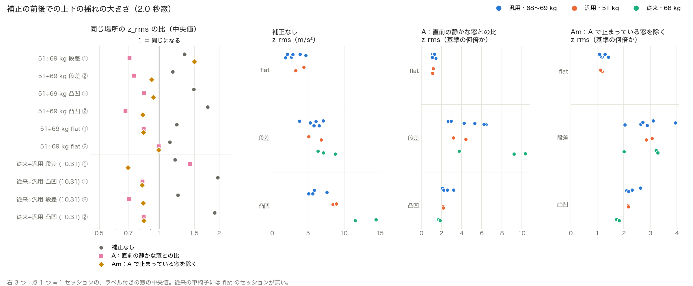

# 補正（体重・車椅子の違い）が効くかの評価

[補正の案](20261101_normalization_ideas.md) の A（直前の静かな走行との比）と D（振幅を変えた水増し）を、補正なしで精度が落ちる条件で試した。[体重の違う人への汎化](20261101_weight_transfer.md) では、68〜69 kg → 51 kg で補正なしでも 0.96〜1.00 で、補正の効果が見えなかったため。

## サマリ

- **補正なしで落ちる条件**：車椅子を変える（汎用 → 従来）と大きく落ちる（core5・2.0 秒で step 0.77、**rough 0.45**）。体重は、軽い人で学習 → 重い人でテスト（51 → 68〜69 kg）で少し落ちる（rough 0.89、1.0 秒では 0.73）。逆向き（68〜69 → 51 kg）は落ちない。
- **A（直前の静かな窓との比）は、今のデータでは採用できない**。hz12 の車椅子のテストは大きく上がる（rough 0.43 → 0.95）が、体重のテスト（51 → 68〜69 kg）の rough は下がり（0.80 → 0.72）、同じ条件の中の評価でも step・rough が下がる。
- 原因は**基準（割る数）が、セッションの中身で決まってしまう**こと。
  - 段差のセッションは、通過の合間に止まっている時間が約 3 割あり、「静かな窓」が止まっているときになる（基準の z_rms 0.6〜2.4）。止まっている窓を除いた版（Am）で、これは直った（1.6〜3.2、flat と同じくらい）。
  - **凸凹のセッションは、ほとんどずっと凸凹なので、基準が凸凹の揺れになる**（1.9〜7.8）。凸凹を凸凹で割るので、凸凹の窓は「基準の約 2 倍」になる。実際の道では、凸凹の前後は平らな道なので、基準は flat の揺れになり、値がまったく違う。**今の「1 セッション = 1 種類の路面」の測り方では、A を正しく評価できない**。
  - hz12 の車椅子のテストが上がったのも、この影響を含む（凸凹のセッションの値が、車椅子によらず「基準の約 2 倍」にそろうため）。従来の車椅子のデータを学習に入れた上限（rough 0.52）より高く、そのまま信用できない。
- **D（水増し）は、どのテストでもほとんど変わらない**（±0.05 以内）。セッション全体を一様に何倍かにしても、体重・車椅子の違い（凸凹は 1.45 倍、flat は 1.2 倍のように、路面で倍率が違う）をまねられないためと考えられる。
- 当面は **core5・補正なし**を基本にする。A を評価するには、**1 回の測定で、平らな道・段差・凸凹を続けて走るデータ**（実際の使い方に近い）が必要。

## 0. 方法

`src/experiments/e20261101_correction_eval.py`。

### テスト

| 名前 | 学習 | テスト |
| --- | --- | --- |
| same | 汎用・68〜69 kg の 18 セッション（セッション単位の LOGO） | 同じ（補正で悪くならないかの確認） |
| chair | 汎用・68〜69 kg の 18 セッション | 従来の車椅子（10.31、68 kg、step 3・rough 2。flat のセッションは無い） |
| light2heavy | 51 kg の 6 セッション | 汎用・68〜69 kg の 18 セッション |
| heavy2light | 汎用・68〜69 kg の 18 セッション | 51 kg の 6 セッション |
| 上限 | 学習とテストを合わせたセッション単位の LOGO | テスト側のセッションだけを集計（補正なし） |

ラベルは方針A・START を 1 秒ずらす。SVM。窓 1.0・2.0 秒。特徴量は core5 と hz12（振幅の特徴量が多いので、補正の効果が出やすい）。

### 補正

| 名前 | 内容 |
| --- | --- |
| none | 補正なし |
| A | 各窓の揺れの大きさの特徴量（z・h の基本4）を、直前 60 秒の窓の 20 パーセンタイルで割る。走り始めの 30 秒は、最初の 30 秒の窓を基準にする。基準には、ラベルの無い窓（通過の合間）も含めた全部の窓を使う |
| Am | A と同じだが、基準に使う窓を、止まっていない窓（z_rms ≥ 1.0 m/s²）に限る |
| A2 | A に加えて、傾きの大きさ（tilt_range・tilt_std、g の基本4）も同じように割る |
| D | 学習のセッションごとに、揺れ・傾きの大きさの特徴量を 0.7・0.85・1.2・1.45 倍したコピーを足す（尖度・クレスト・比は変わらない）。計算した特徴量にメモリ上で倍率をかけるだけで、生データ（`wheelchair_data/`）には何も書かない |
| A+D など | 水増ししてから比をとる |

core5 で割られるのは z_rms だけ（A・Am）。z_rms と tilt_range（A2）。

## 1. 精度（SVM、flat / step / rough）

### 2.0 秒

| 特徴量 | 補正 | same | chair | light2heavy | heavy2light |
| --- | --- | --- | --- | --- | --- |
| core5 | none | 0.95 / 0.95 / 0.94 | – / 0.77 / **0.45** | 0.92 / 0.98 / **0.89** | 1.00 / 0.96 / 0.97 |
| core5 | A | 0.95 / 0.91 / 0.86 | – / 0.93 / 0.48 | 0.91 / 0.95 / 0.83 | 1.00 / 0.94 / 0.96 |
| core5 | Am | 0.95 / 0.93 / 0.88 | – / 0.78 / 0.50 | 0.92 / 0.95 / 0.85 | 1.00 / 0.94 / 0.95 |
| core5 | D | 0.95 / 0.95 / 0.90 | – / 0.78 / 0.40 | 0.90 / 0.99 / 0.89 | 1.00 / 0.96 / 0.97 |
| core5 | Am + D | 0.96 / 0.92 / 0.91 | – / 0.80 / 0.47 | 0.93 / 0.96 / 0.79 | 1.00 / 0.94 / 0.95 |
| core5 | 上限 | | – / 0.79 / 0.68 | 0.95 / 0.96 / 0.93 | 1.00 / 0.97 / 0.97 |
| hz12 | none | 0.91 / 0.91 / 0.87 | – / 0.85 / **0.43** | 0.94 / 0.92 / **0.80** | 1.00 / 0.98 / 0.97 |
| hz12 | A | 0.97 / 0.89 / 0.86 | – / 0.92 / 0.89 | 0.96 / 0.96 / 0.70 | 1.00 / 0.95 / 0.94 |
| hz12 | Am | 0.98 / 0.86 / 0.88 | – / 0.87 / 0.95 | 0.97 / 0.96 / 0.72 | 1.00 / 0.97 / 0.98 |
| hz12 | D | 0.92 / 0.92 / 0.87 | – / 0.84 / 0.40 | 0.88 / 0.95 / 0.82 | 1.00 / 0.97 / 0.99 |
| hz12 | Am + D | 0.98 / 0.89 / 0.89 | – / 0.94 / 0.95 | 0.97 / 0.97 / 0.72 | 1.00 / 0.97 / 1.00 |
| hz12 | 上限 | | – / 0.77 / 0.52 | 0.93 / 0.91 / 0.88 | 1.00 / 0.98 / 0.96 |

### 1.0 秒

| 特徴量 | 補正 | same | chair | light2heavy | heavy2light |
| --- | --- | --- | --- | --- | --- |
| core5 | none | 0.92 / 0.88 / 0.84 | – / 0.79 / 0.51 | 0.87 / 0.92 / **0.73** | 0.97 / 0.92 / 0.93 |
| core5 | Am | 0.95 / 0.82 / 0.80 | – / 0.83 / 0.30 | 0.88 / 0.88 / 0.73 | 0.98 / 0.80 / 0.90 |
| core5 | D | 0.92 / 0.88 / 0.86 | – / 0.75 / 0.47 | 0.86 / 0.93 / 0.76 | 0.97 / 0.91 / 0.91 |
| hz12 | none | 0.90 / 0.83 / 0.81 | – / 0.88 / 0.46 | 0.82 / 0.88 / 0.68 | 0.98 / 0.88 / 0.88 |
| hz12 | Am | 0.97 / 0.81 / 0.78 | – / 0.90 / 0.88 | 0.95 / 0.89 / 0.65 | 0.99 / 0.87 / 0.93 |
| hz12 | Am + D | 0.97 / 0.84 / 0.82 | – / 0.94 / 0.84 | 0.96 / 0.92 / 0.68 | 0.99 / 0.89 / 0.95 |

（A・A2・A+D・A2+D の全部の値は `results.csv`。A2 は、hz12 では A と同じ。hz12 には傾きの特徴量が無いため。）

- **補正なしで一番落ちるのは車椅子**（rough 0.43〜0.51）。従来の車椅子のデータを学習に入れても（上限）rough は 0.52〜0.68 で、従来の車椅子の凸凹は、汎用とかなり違う。
- 体重は、軽い人 → 重い人の向きだけ少し落ちる（2.0 秒の rough 0.89・0.80、1.0 秒の rough 0.73・0.68）。重い人は凸凹の揺れが小さく、flat に近づくため（[体重の違う人への汎化](20261101_weight_transfer.md) の考察どおり）。
- A・Am は、flat を上げる（same で hz12 0.91 → 0.97〜0.98）が、step・rough を下げることが多い。light2heavy の rough は、どの特徴量・窓でも下がる。
- D は、どのテストでもほとんど変わらない。

## 2. 補正の前後での z_rms



左：同じ場所の組の z_rms の比（中央値）。1 に近いほど、補正で条件の違いが消えている。右 3 つ：セッションごとの z_rms の中央値（ラベル付きの窓）。`python -m src.experiments.e20261101_correction_plot` で作る。

| 組 | 補正なし | A | Am |
| --- | --- | --- | --- |
| 51 ÷ 69 kg 段差 ① | 1.34 | 0.71 | 1.50 |
| 51 ÷ 69 kg 段差 ② | 1.17 | 0.75 | 0.92 |
| 51 ÷ 69 kg 凸凹 ① | 1.49 | 0.84 | 0.93 |
| 51 ÷ 69 kg 凸凹 ② | 1.75 | 0.68 | 0.83 |
| 51 ÷ 69 kg flat ① | 1.23 | 0.83 | 0.83 |
| 51 ÷ 69 kg flat ② | 1.13 | 0.99 | 0.99 |
| 従来 ÷ 汎用 段差（10.31）① | 1.20 | 1.43 | 0.70 |
| 従来 ÷ 汎用 凸凹（10.31）① | 1.97 | 0.82 | 0.82 |
| 従来 ÷ 汎用 段差（10.31）② | 1.24 | 0.71 | 0.83 |
| 従来 ÷ 汎用 凸凹（10.31）② | 1.90 | 0.84 | 0.84 |

（2.0 秒窓。場所の番号は [体重の違う人への汎化](20261101_weight_transfer.md) の 2 章と同じ。10.31 の組は、続けて測った同じ場所：段差 ① = `142344` ÷ `142102`、凸凹 ① = `142814` ÷ `143004`、段差 ② = `144130` ÷ `144423`、凸凹 ② = `145240` ÷ `145017`。）

基準（割る数）の z_rms（セッションの中の中央値、2.0 秒）：

| セッションの種類 | A | Am |
| --- | --- | --- |
| flat | 1.6〜4.1 | 1.6〜4.1 |
| 段差 | **0.6〜2.4**（止まっているときを含む） | 1.6〜3.2 |
| 凸凹 | **1.6〜7.7**（凸凹そのもの） | 1.9〜7.8 |

- 比は 1.1〜2.0 から 0.7〜1.0 になり、**補正しすぎる**（1 を越えて反対側に行く）ことが多い。凸凹では、基準が凸凹の揺れになっているので、条件の違いはほぼ消えるが、「凸凹の窓 ÷ 凸凹の基準」で約 2 にそろう（右の図）。
- Am の右の図では、flat は約 1.1〜1.4、凸凹は約 1.7〜2.6、段差は約 2.0〜3.9 にそろって見える。ただし凸凹の値は、凸凹のセッションの中の基準で割ったもので、実際の道（凸凹の前後が平ら）で出る値ではない。

## 3. 考察

- A の考え方（普段の走行の何倍か）は、実際の道では、基準が flat の揺れになる。今のデータは「1 セッション = 1 種類の路面」なので、凸凹のセッションでは基準が凸凹になり、実際とは違う値で学習・評価している。**今の結果は、A が効くか効かないかの証拠にならない**。
- 評価するには、実際の使い方に近いデータが要る。例：1 回の測定で、平らな道 → 段差 → 平らな道 → 凸凹 → 平らな道と続けて走る。各区間の前後に 30〜60 秒の平らな道を入れる。人・車椅子を変えて同じ道を走れば、補正の前後の比較もできる。
- それまでは、**core5・補正なし**を使う。体重の違い（今回の範囲）では大きく落ちず、落ちるのは主に車椅子の違い。車椅子は汎用だけにする方針なので、当面の影響は小さい。
- D は効かなかった。路面ごとに倍率が違う（凸凹 1.45 倍、flat 1.2 倍）ので、一様な倍率の水増しでは足りない。水増しを続けるなら、路面ごとに倍率を変える、周波数をずらす（リサンプリング）などが要る。

## 4. 限界

- 従来の車椅子は 5 セッション（flat なし）、51 kg の人は 6 セッション。
- A の基準のパラメータ（60 秒、20 パーセンタイル、止まっている判定 1.0 m/s²）は 1 通りだけ。
- 各設定 1 回の評価。

## 5. 再現方法

```bash
python -m src.experiments.e20261101_correction_eval
python -m src.experiments.e20261101_correction_plot
```

出力は `data/analysis/20261101_correction_eval/`（`results.csv`、`pair_ratio.csv`、`baseline.csv`、`correction_compare.png`）。図は `docs/knowledge/2026-11-01/images/` にも保存する。
