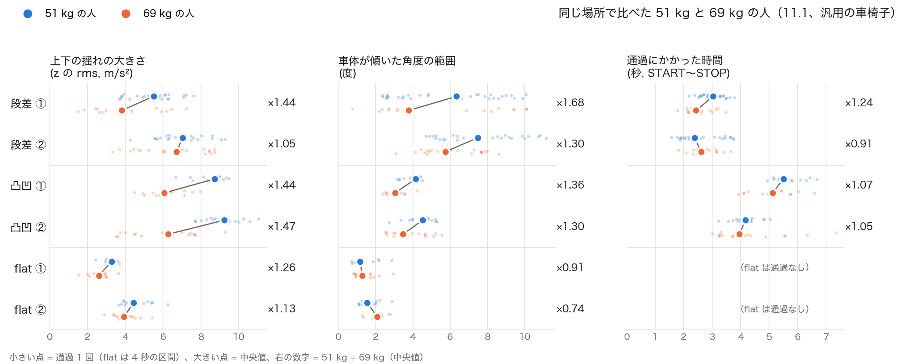

# 体重の違う人への汎化（68〜69 kg で学習 → 51 kg でテスト）

68〜69 kg の人（測定者本人）の全セッションで学習し、51 kg の人の全セッションでテストした。体重が違っても当たるかを調べ、揺れ・傾きの大きさが体重でどれだけ違うかも比べた。

## サマリ

- **体重が違っても、ほとんど落ちない**。SVM・2.0 秒で、core5 は flat / step / rough = **1.00 / 0.96 / 0.97**、hz12 は 1.00 / 0.98 / 0.97。68〜69 kg のセッション単位の評価（core5 で 0.95 / 0.95 / 0.94）と同じか、少し高い。
- 11.1 は、2 人が同じ場所を続けて測っている。**同じ場所の 69 kg のセッションを学習から除いても、10.31（別の日・別の場所）だけで学習しても、2.0 秒では 0.93〜1.00**。場所を覚えているのではない。
- **1.0 秒では、core5 がはっきり強い**（10.31 だけで学習：core5 0.97 / 0.91 / 0.93、hz12 0.97 / 0.85 / 0.83）。
- **51 kg の人のほうが、揺れが大きい**。同じ場所で比べると、上下の揺れ（z の rms）は、凸凹で 1.44〜1.47 倍、flat で 1.14〜1.22 倍。段差は段差 ① で 1.44 倍、段差 ② で 1.05 倍（場所の番号は 2 章の表）。傾きの範囲も 1.3〜1.7 倍（flat を除く）。通過にかかった時間は、凸凹では 1.05〜1.07 倍で、速さはほぼ同じ。
- 揺れは大きくなるが、**大きくなる向きが、他のクラスに近づく向きではない**ので、間違いが増えなかったと考えられる（凸凹は大きく揺れても尖度は低いまま、段差は傾きが大きいまま）。
- **core5 の特徴量ごとの体重の影響**（2 章の最後）：受けやすい順に z_rms ＞ z_kurt（凸凹）・tilt_range ＞ g_low_high ＞ g_over_z。z_kurt は振幅によらないはずだが、軽い人の凸凹は「ずっと揺れ続ける」形になり、尖度が flat に近づく（1.7 → 0.3 前後）。比の 2 個（g_low_high・g_over_z）は体重にほとんどよらない。

## 0. 条件

| 項目 | 内容 |
| --- | --- |
| 学習 | 68〜69 kg の人、汎用の車椅子、18 セッション（10.31 の 8 と 11.1 の 10）。[10.31 + 11.1 の評価](20261101_combined_eval.md) と同じ |
| テスト | 51 kg の人、11.1 の 6 セッション（step 2・rough 2・flat 2） |
| ラベル | 方針A、START を 1 秒ずらす（[ジャイロの特徴量](20261101_gyro_features.md) と同じ） |
| 特徴量 | hz12、m6、hz12 + tilt2 + ratio2（16 個）、core5 |
| モデル | SVM、RF（設定はこれまでと同じ） |
| 指標 | クラスごとの再現率 |

テストの窓数（2.0 秒）：flat 203、step 197、rough 232。

## 1. 精度

### 68〜69 kg の全セッションで学習

| 窓 | 特徴量 | SVM | RF |
| --- | --- | --- | --- |
| 2.0 秒 | hz12 | 1.00 / 0.98 / 0.97 | 1.00 / 0.97 / 0.97 |
| 2.0 秒 | m6 | 0.96 / 0.97 / 0.97 | 0.97 / 0.98 / 0.98 |
| 2.0 秒 | hz12 + tilt2 + ratio2 | 1.00 / 0.98 / 0.97 | 1.00 / 0.98 / 0.97 |
| 2.0 秒 | **core5** | **1.00 / 0.96 / 0.97** | 0.99 / 0.96 / 0.96 |
| 1.0 秒 | hz12 | 0.98 / 0.88 / 0.88 | 0.96 / 0.89 / 0.83 |
| 1.0 秒 | m6 | 0.96 / 0.85 / 0.92 | 0.95 / 0.86 / 0.89 |
| 1.0 秒 | hz12 + tilt2 + ratio2 | 0.98 / 0.93 / 0.92 | 0.98 / 0.93 / 0.87 |
| 1.0 秒 | **core5** | **0.97 / 0.92 / 0.93** | 0.97 / 0.91 / 0.90 |

### 同じ場所を学習に入れない（SVM。その場で集計）

| 窓 | 特徴量 | 10.31 の 68 kg だけで学習 | 同じ場所の 69 kg のセッションを除いて学習 |
| --- | --- | --- | --- |
| 2.0 秒 | hz12 | 1.00 / 0.96 / 0.94 | 0.99 / 0.98 / 0.94 |
| 2.0 秒 | m6 | 0.96 / 0.97 / 0.93 | 0.95 / 0.97 / 0.94 |
| 2.0 秒 | **core5** | **1.00 / 0.95 / 0.97** | **1.00 / 0.96 / 0.96** |
| 1.0 秒 | hz12 | 0.97 / 0.85 / 0.83 | 0.97 / 0.86 / 0.86 |
| 1.0 秒 | m6 | 0.96 / 0.86 / 0.87 | 0.96 / 0.84 / 0.89 |
| 1.0 秒 | **core5** | **0.97 / 0.91 / 0.93** | **0.97 / 0.90 / 0.92** |

（「同じ場所」は、2 人が続けて測ったセッションの組。2 章の「場所の番号」の表を参照。）

### セッションごと（2.0 秒・SVM・core5）

| 種類 | セッション | 窓数 | 再現率 | 間違い |
| --- | --- | --- | --- | --- |
| step | 20261101140355 | 128 | 0.99 | rough 1 |
| step | 20261101142036 | 69 | **0.91** | rough 6 |
| rough | 20261101141512 | 129 | 0.98 | flat 3 |
| rough | 20261101142926 | 103 | 0.95 | flat 5 |
| flat | 20261101141139 | 94 | 1.00 | |
| flat | 20261101142633 | 109 | 1.00 | |

- 一番低いのは段差の `142036`（段差 ②）。69 kg の人の同じ場所（`142339`）も、[10.31 + 11.1 の評価](20261101_combined_eval.md) で低かった（0.81〜0.86）。体重ではなく、段差 ② の前後の路面が粗いためと考えられる。

## 2. 揺れ・傾きの大きさの違い

通過ごと（START + 1 秒 〜 STOP）に、揺れと傾きの大きさを出し、同じ場所の 2 人で中央値を比べた。flat はセッション全体で比べた。

### 場所の番号

11.1 に、2 人が同じ場所を続けて測ったセッションの組に、種類ごとに番号を付けた（測った順）。

| 場所 | 51 kg の人 | 69 kg の人 | [10.31 + 11.1 の評価](20261101_combined_eval.md) での呼び方 |
| --- | --- | --- | --- |
| 段差 ① | `20261101140355` | `20261101140700` | 場所 A |
| 段差 ② | `20261101142036` | `20261101142339` | 場所 C |
| 凸凹 ① | `20261101141512` | `20261101141730` | 場所 A |
| 凸凹 ② | `20261101142926` | `20261101143126` | 場所 D（凸凹 ① から西に約 220 m） |
| flat ① | `20261101141139` | `20261101141253` | |
| flat ② | `20261101142633` | `20261101143455` | （同じ場所かどうか未確認） |

（A・C・D は、以前の解析で GPS の位置から付けた呼び方。）

### 比較

| 場所 | 通過の数（51 / 69 kg） | 時間 | z の rms | z の 99 パーセンタイル | h の rms | 傾きの速さ（g の rms） | 傾きの範囲 |
| --- | --- | --- | --- | --- | --- | --- | --- |
| 段差 ① | 32 / 19 | ×1.24 | **×1.44**（5.50 / 3.81） | ×1.59 | ×1.05 | ×1.22 | **×1.68**（6.3 / 3.8 度） |
| 段差 ② | 24 / 21 | ×0.91 | ×1.05（7.03 / 6.72） | ×0.98 | ×0.85 | ×0.98 | ×1.30（7.5 / 5.8 度） |
| 凸凹 ① | 14 / 14 | ×1.07 | **×1.44**（8.72 / 6.06） | ×1.27 | ×1.21 | ×1.37 | ×1.36 |
| 凸凹 ② | 16 / 18 | ×1.05 | **×1.47**（9.23 / 6.27） | ×1.31 | ×1.14 | ×1.38 | ×1.30 |
| flat ① | セッション全体 | | ×1.22（3.23 / 2.64） | ×1.19 | ×0.84 | ×0.98 | ×1.06 |
| flat ② | セッション全体 | | ×1.14（4.63 / 4.05） | ×1.13 | ×0.83 | ×1.06 | ×0.59 |

（× は 51 kg ÷ 69 kg。括弧は 51 kg / 69 kg の値。加速度は m/s²。）



小さい点 = 通過 1 回（flat は 4 秒の区間）、大きい点 = 中央値、右の数字 = 51 kg ÷ 69 kg（中央値）。青 = 51 kg、オレンジ = 69 kg。`python -m src.experiments.e20261101_weight_transfer_plot` で作る。図では、flat を通過と長さをそろえるため 4 秒ずつの区間に区切って比べたので、flat の比は上の表（セッション全体）と違う（z の rms ×1.26・×1.13、傾きの範囲 ×0.91・×0.74）。flat の傾きの範囲は、セッション全体では長い時間のゆっくりした傾きの変化を含むので、図の値のほうが比べやすい。

段差の向き別（全セッション、中央値）：

| 向き | z の rms（51 / 68〜69 kg） | 傾きの範囲 | 時間 |
| --- | --- | --- | --- |
| 下り | 5.58 / 6.17 | 4.7 / 5.0 度 | 2.60 / 2.44 秒 |
| 上り（乗り越えた） | 6.29 / 6.77 | 8.8 / 8.5 度 | 3.14 / 2.72 秒 |
| 上り（止まった） | 5.54 / 3.76 | 10.2 / 8.4 度 | 3.75 / 2.75 秒 |

（上り・止まったは、51 kg が 1 回だけ。）

- **凸凹では、51 kg の人のほうが上下の揺れが約 1.45 倍大きい**。通過の時間はほぼ同じ（×1.05〜1.07）なので、速さの違いではなく、体重（軽いと揺れが抑えられにくい）か、乗り方・押し方の違いと考えられる。
- 段差は場所によって違う（段差 ① は 1.44 倍、段差 ② は 1.05 倍）。向き別にまとめると、下り・上りとも、体重による違いは小さい（0.9 倍前後）。段差 ① の違いは、通過の数や、上り・下りの割合の違いも含んでいる可能性がある。
- flat も、上下の揺れが 1.14〜1.22 倍大きい。水平の揺れ（h）は、逆に 0.83〜0.84 倍と小さい。
- 傾きの範囲は、段差・凸凹で 1.3〜1.7 倍大きい。軽いと、前輪が持ち上がりやすい・車体が揺られやすいためと考えられる。

### core5 の特徴量ごとの体重の影響

同じ場所の 6 組で、core5 の各特徴量の、セッションごとの中央値（ラベル付きの窓、2.0 秒）を比べた。体重による差（51 kg − 69 kg）を、クラスどうしの差（68〜69 kg の人の、クラスごとの中央値）と並べた（その場で集計）。

| 特徴量 | 体重の影響 | 51 kg − 69 kg（同じ場所） | クラスどうしの差（68〜69 kg の中央値） |
| --- | --- | --- | --- |
| **z_rms**（上下の揺れの大きさ） | **大きい** | flat +0.5〜0.6、段差 +1.0〜1.3、**凸凹 +2.8〜3.8** | flat 3.0 ↔ 凸凹 6.1（差 3.0）、段差 5.9 |
| **z_kurt**（単発の衝撃か、続く揺れか） | **中くらい**（凸凹で効く） | flat ほぼ 0、段差 +0.7〜1.7、**凸凹 −1.4〜−1.9** | flat 0.1 ↔ 凸凹 1.7（差 1.6）、凸凹 ↔ 段差 8.4（差 6.7） |
| **tilt_range**（傾いた角度の範囲） | **中くらい** | flat ほぼ 0、凸凹 +0.6〜1.0、段差 −0.7〜+2.9 | flat 1.2 ↔ 凸凹 3.0 ↔ 段差 7.3（度） |
| **g_low_high**（ゆっくり ÷ 速い傾き、log10） | **小さい** | −0.19〜+0.13 | flat −0.79 ↔ 凸凹 −0.61 ↔ 段差 −0.03 |
| **g_over_z**（傾き ÷ 上下の揺れ、log10） | **ほとんど無い** | −0.01〜−0.08（倍率で 0.83〜0.98 倍） | flat −0.98 ↔ 凸凹 −0.84・段差 −0.82 |

- **z_rms**：凸凹では、体重による差（+2.8〜3.8）が、flat と凸凹の差（3.0）と同じくらい。軽い人では凸凹が flat から離れる向きなので問題ないが、重い人では flat に近づく向き。51 kg で学習 → 68〜69 kg でテストで rough が下がる（[補正の評価](20261101_correction_eval.md) の light2heavy、2.0 秒で 0.89）のは、主にこのため。
- **z_kurt**：尖度は振幅を何倍にしても変わらないが、体重が変わると波形の形そのものが変わる。軽い人の凸凹は「ずっと揺れ続ける」形になり、尖度が flat の値に近づく（69 kg の人 1.7 → 51 kg の人 0.3 前後）。「振幅によらない特徴量」でも、体重の影響を受ける。
- **tilt_range**：軽い人のほうが大きく傾く。凸凹では +0.6〜1.0 で、凸凹と段差の差（4.4）より十分小さい。flat ではほぼ変わらない。
- **g_low_high・g_over_z**：比なので、体重による違いが分母と分子で打ち消し合う。g_over_z が一番強い。
- core5 は、体重の影響を受けやすいもの（z_rms）と受けにくいもの（比の 2 個）が混ざっている。どれか 1 つがずれても、ほかで支えられるので、補正なしでも大きく落ちなかったと考えられる。
- 1 人ずつ、6 組だけの比較。いろいろな体重の人で確かめると、数字は変わる可能性がある。

## 3. 考察

- 揺れの大きさは、体重で 1.0〜1.5 倍ほど変わる。それでも間違いが増えなかったのは、**揺れが大きくなっても、他のクラスとの境目を越えない**ため。
  - 凸凹が大きく揺れても、「続く揺れ」（尖度が低い）のままなので、段差にはならない。flat からはむしろ離れる。
  - 段差は、傾きの範囲が大きいまま（51 kg で 6.9 度、窓の中央値）なので、凸凹と区別できる。
  - flat も揺れは大きくなるが、51 kg の flat の z の rms（3.8、窓の中央値）は、凸凹（8.7）からまだ遠い。
- 逆の向き、つまり**重い人**では、凸凹の揺れが小さくなり、flat に近づく可能性がある。今回は「重い人で学習 → 軽い人でテスト」の向きだけを確かめた。
- 1.0 秒では、hz12 の step・rough が 0.83〜0.88 まで下がるが、core5 は 0.90〜0.93 を保つ。窓が短いときは、傾きの特徴量が効く。

## 4. 限界

- 51 kg の人は 1 人、6 セッション、1 日だけ。
- 押していた人や乗り方の違いは記録していない。体重以外の違いも、揺れの差に含まれている可能性がある。
- テストの 51 kg のセッションには、10.31 で除いた `150809` や 11.1 の `143126` のような、単発の衝撃が混ざる凸凹がなかった。
- 各設定 1 回の評価。

## 5. 再現方法

```bash
python -m src.experiments.e20261101_weight_transfer
```

出力は `data/analysis/20261101_weight_transfer/`（`results.csv`、`confusion.csv`、`by_session.csv`、`passes.csv`、`windows.csv`）。同じ場所を学習に入れない評価、同じ場所どうしの比較、core5 の特徴量ごとの体重の影響は、その場で集計した。
