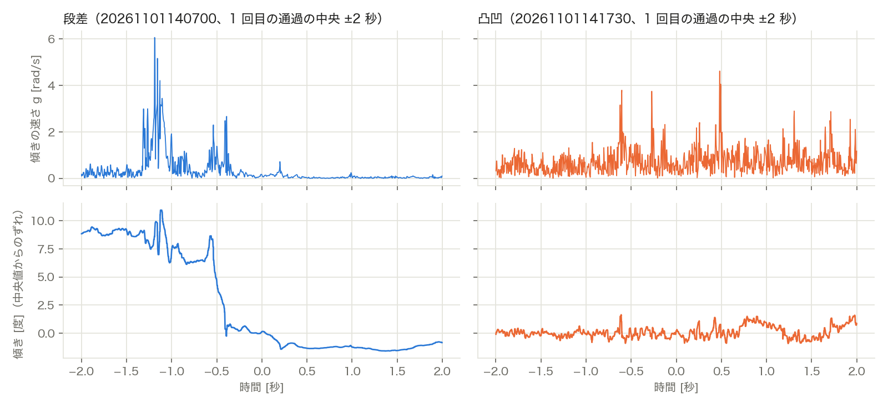
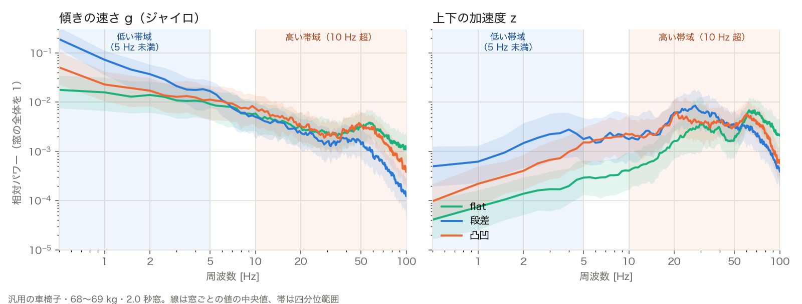
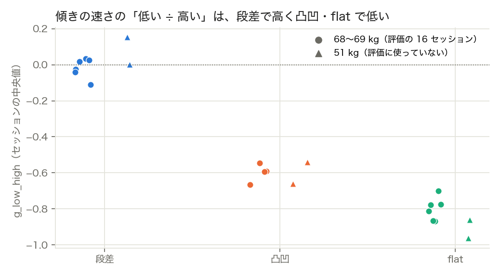

# g_low_high（傾きの速さの「低い周波数 ÷ 高い周波数」）を使う根拠

[ジャイロの特徴量](../2026-11-01/20261101_gyro_features.md)（11.1）で足した `g_low_high` は、第 17 回ゼミの資料（131-017）では外した。

- 境目（5 Hz 未満・10 Hz 超）と、5〜10 Hz を除く理由を調べていなかったため。
- ゼミ資料の core（暫定）は、`g_low_high` を除いて絞り直した 5 個（z_rms・z_kurt・h_std・h_crest・tilt_range）。

ここでは、傾きの速さ g の周波数を解析して、次の 3 つを確かめた。

1. `g_low_high` が効く理由（見立て）がデータと合っているか。
2. 境目の決め方で結果が変わらないか。
3. core に足したときに精度が上がるか。

## まず全体の説明（ゼミ向け）

発表するときは、次の順に話すとよい。

1. **見立て（物理的な根拠）**
   - 段差では、前輪の乗り上げや後輪の落下で、**車体全体がまとまって大きく傾く**。このため、傾きの速さ g はゆっくり変わる（低い周波数）。
   - 凸凹では、車体は**細かく速く揺れるだけ**で、大きくは傾かない。このため、g は速く変わる（高い周波数）。
   - したがって、g の「低い周波数のパワー ÷ 高い周波数のパワー」は、段差で大きく、凸凹で小さくなるはず。
2. **確かめた（図 1）**
   - g の周波数ごとのパワーを、クラスごとに比べた。
   - 段差は、5 Hz 未満にパワーの約 40% がある。凸凹は約 17%、flat は約 12%。
   - 10 Hz 超は逆で、段差 42%、凸凹 68%、flat 77%。
   - 段差と凸凹の線は、**約 7 Hz で入れ替わる**。
   - 加速度 z で同じ比をとると、段差と凸凹の差は小さい（AUC 0.80。g は 0.97）。
3. **特徴量にした**
   - log10（5 Hz 未満のパワー ÷ 10 Hz 超のパワー）。
   - 5〜10 Hz は、段差と凸凹の線が入れ替わる帯域で、パワーの割合も 0.16 と 0.14 でほぼ同じ。区別の手がかりが少ないので除いた。
   - 除かなくても、結果はほぼ同じ（4 章）。
4. **結果**
   - ゼミで発表した core に足すと、段差 ↔ 凸凹の取り違えが **39 → 22 窓**、rough が **0.91 → 0.93** になった（SVM・2.0 秒）。
   - 境目を 2〜10 Hz・2〜30 Hz の範囲で変えても、取り違えは 16〜29 窓で、どれも core（39 窓）より少ない。
   - 評価に使っていない 51 kg の人のデータでも、同じ傾向が出た（図 2）。

### 話すときに気をつけること（経緯）

- **見立ては、特徴量を作る前からあった**。
  - 2026-10-04 の [次の測定の計画](../2026-10-04/20261004_next_measurement_plan.md)（4.3）に、「段差では、キャスターの乗り上げや後輪の落下で、車体のピッチが瞬間的に変化するため、角速度に特徴が出る可能性がある」と書いて、ジャイロを記録するようにした。
  - 11.1 に `g_low_high` を足したときも、「段差はゆっくり大きく傾く」という見立てで足した。
- **スペクトルの確認と、境目の検討は、このメモ（11.4）で行った**。
  - 5 Hz・10 Hz という境目は、11.1 の時点ではスペクトルを見ずに決めた値。
  - 「スペクトルを見て境目を決めた」とは言わない。言ってよいのは次の 2 つ。
    - 「スペクトルで見立てを確かめ、境目が、段差と凸凹の線が入れ替わる 7 Hz 付近を挟んでいることを確かめた」
    - 「境目を変えても、結果はほぼ同じ」

## サマリ

- **段差は、傾きの速さ g のパワーが低い周波数に集まる**。
  - 5 Hz 未満の割合（窓ごとの中央値、2.0 秒）は、段差 0.40、凸凹 0.17、flat 0.12。
  - 10 Hz 超の割合は、段差 0.42、凸凹 0.68、flat 0.77。
  - 段差と凸凹の相対パワーの線は、約 7 Hz で入れ替わる（51 kg では 6.5〜8 Hz）。
- **セッションごとに見ても、段差と凸凹は重ならない**。`g_low_high` のセッションの中央値は次のとおり。
  - 段差：−0.11〜0.15（8 セッション）
  - 凸凹：−0.67〜−0.54（6 セッション）
  - flat：−0.96〜−0.70（8 セッション）
  - これには、評価に使っていない 51 kg の人の 6 セッションも含む。
- **加速度 z で同じ比をとっても、段差と凸凹はあまり分かれない**。段差 ↔ 凸凹の AUC は、z で 0.80、g で 0.97（境目 5・10 Hz、2.0 秒）。
  - これは、[10.17 の帯域パワー比](../2026-10-17/20261017_added_features_eval.md)（加速度）が、段差と凸凹の区別を上げなかったことと合う。
  - 理由は、ゆっくりした大きな傾きが、加速度には小さくしか出ず、角速度には大きく出るため（5 章）。
- **境目の決め方には、ほとんどよらない**。
  - 低い帯域の上限を 2〜10 Hz、高い帯域の下限を 2〜30 Hz で変えると、AUC は 0.94〜0.97 だった。
  - core に足したときの取り違えは 16〜29 窓だった。
  - 5〜10 Hz を除いた場合（5 Hz 未満 ÷ 10 Hz 超）と除かない場合（5 Hz 未満 ÷ 5 Hz 以上）は、AUC が 0.966 と 0.963、取り違えが 22 窓と 21 窓で、ほぼ同じ。
- **ゼミの core に足すと、段差 ↔ 凸凹の取り違えが減る**。
  - 2.0 秒：0.96 / 0.95 / 0.91（39 窓）→ 0.95 / 0.96 / 0.93（22 窓）
  - 1.0 秒：0.91 / 0.87 / 0.83（181 窓）→ 0.92 / 0.88 / 0.85（150 窓）
  - flat は 0.956 → 0.946 と、少し下がる。
- **体重のテストでも、悪くならない**。
  - 51 kg で学習 → 68〜69 kg でテスト（2.0 秒）で、取り違えは 40 → 29 窓。rough は 0.88 のまま。
  - 逆向き（68〜69 kg で学習 → 51 kg でテスト）は、もともと 0.97〜1.00 で変わらない。
- **結論：`g_low_high` は、見立て（物理）とデータの両方で根拠を示せる。ただし、入れたことによる改善ははっきりしない**。
  - 2.0 秒では、正解に変わった窓が 24、不正解に変わった窓が 18 で、差は 6 窓（全体 1713 窓）。セッションごとでは、上がった 5・下がった 6・ほぼ同じ 5。段差 ↔ 凸凹の取り違えは減るが、flat の間違いが増える。
  - 1.0 秒では、上がった 10・下がった 3 で傾向はそろうが、符号検定では p ≈ 0.09。
  - **2026-11-04 の判断：当面は core に入れない**（ゼミ資料の core のまま）。短い窓を使うことになったら、もう一度検討する。
  - 境目は、これまでの結果と比べられるように、5 Hz・10 Hz のままにする。

## 0. 方法

`src/experiments/e20261104_g_low_high_rationale.py`。

| 項目 | 内容 |
| --- | --- |
| データ | 10.31 と 11.1 の、汎用の車椅子・68〜69 kg の **16 セッション**（step 6・rough 4・flat 6。`configs/sessions/` の `use=yes`）。研究メモの「18 セッション」は数え間違い（ゼミ資料のリポジトリの `knowledge/semi/2026-11-03/seminar_feedback.md` の 2 章） |
| 確認用のデータ | 11.1 の 51 kg の人の 6 セッション（step 2・rough 2・flat 2）。スペクトルの傾向の確認と、体重のテストだけに使った |
| ラベル | 方針A、START を 1 秒後ろにずらす（[ジャイロの特徴量](../2026-11-01/20261101_gyro_features.md) と同じ） |
| g | 水平の角速度の大きさ √(ωx² + ωy²)（世界座標系）。車体が前後・左右に傾く速さ。作り方は [ジャイロの特徴量](../2026-11-01/20261101_gyro_features.md) の 0 章と同じ |
| 窓 | 2.0 秒（主）・1.0 秒。窓幅の 1/4 ずつずらす |
| スペクトル（図 1） | 窓ごとに平均を引き、ハン窓をかけて periodogram を計算し、全体のパワーで割った（相対パワー）。クラスごとに、窓ごとの値の中央値と四分位範囲を出した。周波数の分解能は 0.5 Hz（2.0 秒窓） |
| g_low_high | `e20261101_gyro_features` と同じ計算。窓の g から welch（nperseg = 256、約 1.3 Hz ごと）でパワーを求め、log10（f < 5 Hz のパワーの和 ÷ f > 10 Hz のパワーの和）を出す。境目を変えた版も同じ計算で、5 Hz・10 Hz だけを変えた |
| 区別の強さ | 特徴量 1 個での AUC（段差 ↔ 凸凹など）。学習はしない |
| 精度 | SVM（標準化 + RBF、C=1.0、`class_weight="balanced"`）、セッション単位の LOGO（16 グループ）。クラスごとの再現率と、段差 ↔ 凸凹の取り違え（step → rough + rough → step の窓数） |
| core | ゼミ資料 131-017 の core（暫定）：z_rms・z_kurt・h_std・h_crest・tilt_range。この条件で 0.96 / 0.95 / 0.91・39 窓となり、ゼミ資料の値を再現した |

窓数（2.0 秒）：68〜69 kg は flat 840・step 465・rough 408。51 kg は flat 203・step 197・rough 232。

## 1. 見立て（物理的な根拠）

| | 段差 | 凸凹 |
| --- | --- | --- |
| 車体の動き | 前輪が乗り上げる・落ちる、後輪が乗り上げる・落ちる。**車体全体が、まとまって大きく傾く** | 小さな凸凹を次々に越える。**車体は細かく揺れるが、大きくは傾かない** |
| 傾き（tilt） | 数度〜10 度ほど変わる（図 3 の例では約 9 度） | ±1 度ほどの細かい揺れ |
| 傾きの速さ g の周波数 | ゆっくりした成分（低い周波数）が多いはず | 速い成分（高い周波数）が多いはず |

- **傾きの範囲（tilt_range）だけでは足りない理由**：tilt_range は「どれだけ傾いたか」（大きさ）しか見ない。段差が低い、または坂道の上の凸凹のときは、範囲が重なる。
  - 実際、段差の `20261031142102`（3.9 度）は、凸凹の `20261101142926`（51 kg、3.9 度）と同じくらい（[ジャイロの特徴量](../2026-11-01/20261101_gyro_features.md) の 2 章でも指摘）。
  - `g_low_high` は「どれだけの速さで傾いたか」（形）を見るので、大きさが同じでも区別できるはず。この 2 つのセッションでは、`g_low_high` は 0.03 と −0.66 で、はっきり分かれる（3 章）。
- **比なので、揺れの大きさによらない**：体重で揺れが大きくなっても、低い帯域と高い帯域が同じように大きくなれば、比は変わらない。
  - [周波数帯の特徴量](../2026-11-01/20261101_band_features.md) の 2 章では、体重による差は z_rms が 0.33、`g_low_high` が 0.14（標準化した単位）で、`g_low_high` のほうが体重の影響を受けにくい。



図 3：段差（`20261101140700`）と凸凹（`20261101141730`）の、1 回目の通過の中央 ±2 秒。同じ人（69 kg）・同じ日。段差では、傾きが約 9 度まとまって変わる。凸凹では、g は細かく速く揺れ続けるが、傾きはほとんど変わらない。

## 2. 傾きの速さ g のスペクトル



図 1：窓ごとの相対パワースペクトル（窓の全体のパワーを 1 とする）の、クラスごとの中央値。左は傾きの速さ g、右は上下の加速度 z。汎用の車椅子・68〜69 kg・2.0 秒窓。

帯域ごとのパワーの割合（窓ごとの値の中央値、2.0 秒。welch で計算した、`g_low_high` と同じスペクトル）：

| 人 | クラス | 5 Hz 未満 | 5〜10 Hz | 10 Hz 超 | g_low_high |
| --- | --- | --- | --- | --- | --- |
| 68〜69 kg | 段差 | **0.40** | 0.16 | 0.42 | −0.03 |
| 68〜69 kg | 凸凹 | 0.17 | 0.14 | **0.68** | −0.61 |
| 68〜69 kg | flat | 0.12 | 0.11 | **0.77** | −0.79 |
| 51 kg | 段差 | **0.45** | 0.17 | 0.35 | 0.12 |
| 51 kg | 凸凹 | 0.17 | 0.13 | **0.68** | −0.60 |
| 51 kg | flat | 0.10 | 0.09 | **0.80** | −0.92 |

（割合は窓ごとの中央値なので、行の和は 1 にならない。）

- **g では、段差の相対パワーが 5 Hz 未満で凸凹・flat より大きく、約 7 Hz で凸凹と入れ替わる**。10 Hz より上では、凸凹・flat のほうが大きい。見立てのとおり。
- 51 kg の人でも同じ形で、入れ替わる周波数も 6.5〜8 Hz でほぼ同じ。
- **5〜10 Hz の割合は、段差 0.16、凸凹 0.14 でほぼ同じ**。入れ替わる帯域なので、どちらのクラスにも寄らない。
- 加速度 z（右）でも、段差は 5 Hz 未満の相対パワーが凸凹より大きい。ただし、5 Hz より上では段差と凸凹がほぼ重なり、四分位範囲も大きく重なる。z で同じ比をとったときの段差 ↔ 凸凹の AUC は 0.80 で、g（0.97）より低い（4 章）。

## 3. セッションごと



図 2：セッションごとの `g_low_high` の中央値（2.0 秒）。丸 = 68〜69 kg（評価の 16 セッション）、三角 = 51 kg（評価に使っていない）。

| クラス | 68〜69 kg | 51 kg |
| --- | --- | --- |
| 段差 | −0.11〜0.03（6 セッション） | 0.00・0.15 |
| 凸凹 | −0.67〜−0.55（4 セッション） | −0.66・−0.54 |
| flat | −0.87〜−0.70（6 セッション） | −0.96・−0.86 |

- 段差と凸凹は、日・場所・人によらず、セッションの中央値が重ならない。
- 段差の `20261031142102`（傾きの範囲 3.9 度。段差の中で一番小さく、凸凹と同じくらい）も、`g_low_high` は 0.03 で、段差の側にある。**傾きの範囲で見分けにくい段差を、`g_low_high` で見分けられる**。
- 揺れの大きい flat の `20261031150048`（−0.70）は、凸凹（−0.55〜−0.67）に近い。`g_low_high` は、flat と凸凹の区別にはあまり効かない（AUC 0.75）。

## 4. 境目を変える

低い帯域を f < a、高い帯域を f > b として、a・b を変えた（a = b はすき間なし）。どれも 68〜69 kg の 16 セッション、2.0 秒。

### 段差 ↔ 凸凹の AUC（特徴量 1 個。上：g、下：比べるための加速度 z）

| a \ b | 2 | 3 | 5 | 7 | 10 | 15 | 20 | 30 |
| --- | --- | --- | --- | --- | --- | --- | --- | --- |
| 2 | 0.938 | | 0.953 | | 0.963 | 0.964 | 0.966 | 0.971 |
| 3 | | 0.955 | 0.959 | | 0.966 | 0.966 | 0.966 | 0.970 |
| **5** | | | 0.963 | | **0.966** | 0.966 | 0.966 | 0.970 |
| 7 | | | | 0.965 | 0.963 | 0.963 | 0.962 | 0.967 |
| 10 | | | | | 0.957 | 0.956 | 0.956 | 0.961 |

| a \ b（z） | 2 | 3 | 5 | 7 | 10 | 15 | 20 | 30 |
| --- | --- | --- | --- | --- | --- | --- | --- | --- |
| 2 | 0.817 | | 0.818 | | 0.817 | 0.819 | 0.819 | 0.840 |
| 3 | | 0.825 | 0.825 | | 0.823 | 0.822 | 0.823 | 0.845 |
| **5** | | | 0.805 | | **0.802** | 0.801 | 0.801 | 0.826 |
| 7 | | | | 0.700 | 0.698 | 0.697 | 0.699 | 0.736 |
| 10 | | | | | 0.634 | 0.635 | 0.638 | 0.677 |

### core に足したときの、段差 ↔ 凸凹の取り違え（窓数。core だけでは 39）

| a \ b | 2 | 3 | 5 | 7 | 10 | 15 | 20 | 30 |
| --- | --- | --- | --- | --- | --- | --- | --- | --- |
| 2 | 29 | | 28 | | 22 | 22 | 21 | 20 |
| 3 | | 24 | 23 | | 18 | 17 | 21 | 21 |
| **5** | | | 21 | | **22** | 22 | 22 | 21 |
| 7 | | | | 18 | 18 | 19 | 18 | 16 |
| 10 | | | | | 20 | 21 | 22 | 19 |

- g の AUC は、どの境目でも 0.94〜0.97 で、z（0.63〜0.85）よりはっきり高い。**効いているのは「g の低い ÷ 高い」という形で、5・10 という値ではない**。
- 低い帯域の上限を 2 Hz まで下げると、少し弱くなる（AUC 0.938、取り違え 29）。段差の傾きの成分は、2 Hz より上（2〜5 Hz）にも多い。
- 5〜10 Hz を除く（a = 5・b = 10）か除かない（a = b = 5）かで、AUC は 0.966 と 0.963、取り違えは 22 と 21。**5〜10 Hz を除くことは、結果をほとんど変えない**。除く理由としては、「段差と凸凹の線が入れ替わる帯域（2 章）で、区別の手がかりが少ない」と説明できる。ただし、除かなくても同じなので、除くことが必要だったわけではない。
- 1.0 秒でも同じ傾向。g の AUC は 0.78〜0.83、z は 0.50〜0.69。取り違えは、a = 2・3 で 161〜177 窓、a ≥ 5 で 150〜160 窓（core は 181 窓）。1.0 秒では、低い帯域の上限を 5 Hz 以上にしたほうがよい。

## 5. core に足したときの精度

| 窓 | 特徴量 | flat / step / rough | 段差 ↔ 凸凹 |
| --- | --- | --- | --- |
| 2.0 秒 | core（ゼミ資料） | 0.96 / 0.95 / 0.91 | 39 |
| 2.0 秒 | **core + g_low_high** | **0.95 / 0.96 / 0.93** | **22** |
| 2.0 秒 | 研究メモの core5（参考） | 0.95 / 0.95 / 0.94 | 33 |
| 2.0 秒 | core5 − g_low_high（参考） | 0.95 / 0.92 / 0.89 | 63 |
| 1.0 秒 | core（ゼミ資料） | 0.91 / 0.87 / 0.83 | 181 |
| 1.0 秒 | **core + g_low_high** | **0.92 / 0.88 / 0.85** | **150** |

体重のテスト（境目 5・10 Hz）：

| 窓 | テスト | core | core + g_low_high |
| --- | --- | --- | --- |
| 2.0 秒 | 68〜69 kg → 51 kg | 1.00 / 0.98 / 0.97（4 窓） | 1.00 / 0.97 / 0.98（6 窓） |
| 2.0 秒 | 51 kg → 68〜69 kg | 0.96 / 0.97 / 0.88（40 窓） | 0.95 / 0.98 / 0.88（29 窓） |
| 1.0 秒 | 68〜69 kg → 51 kg | 0.97 / 0.92 / 0.90（28 窓） | 0.97 / 0.92 / 0.89（30 窓） |
| 1.0 秒 | 51 kg → 68〜69 kg | 0.84 / 0.93 / 0.78（208 窓） | 0.85 / 0.93 / 0.79（185 窓） |

- 2.0 秒・1.0 秒とも、step・rough が上がり、段差 ↔ 凸凹の取り違えが減る（2.0 秒で約 4 割、1.0 秒で約 2 割）。flat は 2.0 秒で 0.956 → 0.946 と少し下がる。
- 研究メモの core5（g_low_high・g_over_z あり）から `g_low_high` を外すと、取り違えが 33 → 63 窓に増える（[ジャイロの特徴量](../2026-11-01/20261101_gyro_features.md) の 4 章と同じ）。どちらの組み合わせでも、`g_low_high` は段差 ↔ 凸凹の区別を担っている。
- 体重のテストでは、段差 ↔ 凸凹の取り違えは減るか、ほぼ同じ。rough の再現率は変わらない。

## 6. 考察

- **なぜ加速度ではなく角速度で効くのか**：同じ揺れでも、周波数 f の動きでは、加速度は「変位 × (2πf)²」、角速度は「角度 × 2πf」で大きさが決まる。
  - 加速度は高い周波数ほど大きく出るので、ゆっくりした大きな傾き（段差）は、衝撃やフレームのブルブル（[周波数帯の特徴量](../2026-11-01/20261101_band_features.md) の固有振動数 15〜30 Hz）に埋もれる。
  - 角速度は f に比例するだけで、加速度ほど高い周波数に偏らない。このため、ゆっくりした大きな傾きが見えやすい。
  - これは、加速度の帯域パワー比（[10.17](../2026-10-17/20261017_added_features_eval.md)）や周波数の特徴量（[10.6](../2026-10-06/20261006_related_work_features_eval.md)）が段差と凸凹を分けなかったことと、g では分けられたことの説明になる。
- **tilt_range との違い**：tilt_range は傾きの大きさ、`g_low_high` は傾き方の速さ（形）。段差の低い `20261031142102` のように、大きさでは凸凹と重なる段差を、形で見分けている（3 章）。
- **flat ↔ 凸凹には、あまり効かない**（AUC 0.75）。flat と凸凹はどちらも高い周波数が多いため。flat ↔ 凸凹は、これまでどおり揺れの大きさ（z_rms など）で見分けている。

## 7. 限界

- 境目を変えた比較は、評価と同じ 16 セッションで行った。ただし、どの境目でもほぼ同じ結果なので、境目を選んだことによる楽観は小さいと考える。スペクトルの傾向は、評価に使っていない 51 kg の 6 セッションでも同じだった。
- 速度は、確かめた範囲ではほぼ同じ（基準の flat で 1.04・1.20 m/s。[人ごとの平坦路の基準](../2026-11-01/20261101_person_calib.md)。凸凹の通過時間は 2 人で 1.05〜1.07 倍。[体重の違う人への汎化](../2026-11-01/20261101_weight_transfer.md)）。速度が変わると、段差を越える時間が変わり、低い帯域の成分の周波数もずれる（遅いほど低く、速いほど高く）。5 Hz の境目が、速い走行でも足りるかは未確認。
- 段差の高さ・凸凹の種類は、10.31・11.1 の数か所だけ。低い段差、坂道の上の凸凹では、傾き方が違う可能性がある。
- 車椅子は汎用の 1 台だけ。
- 各設定 1 回の評価。

## 8. 再現方法

```bash
python -m src.experiments.e20261104_g_low_high_rationale
```

出力は `data/analysis/20261104_g_low_high_rationale/` です。

- `psd_class.csv`：クラスごとの相対パワースペクトル
- `band_session.csv`：セッションごとの帯域の割合と g_low_high
- `variants.csv`：境目ごとの AUC と精度
- `transfer.csv`：体重のテスト
- 図 3 枚：`docs/knowledge/2026-11-04/images/` にも保存する
