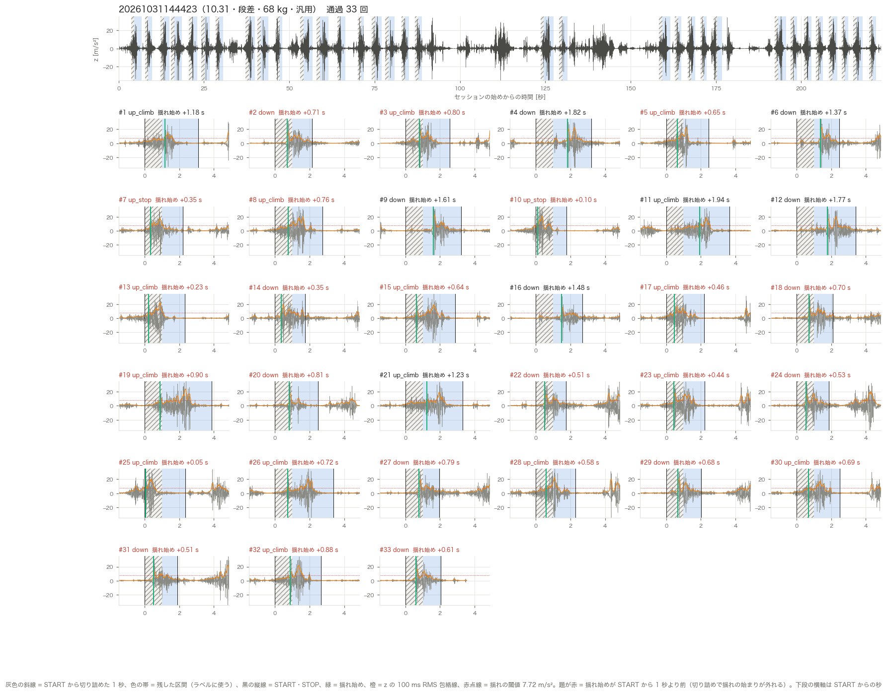
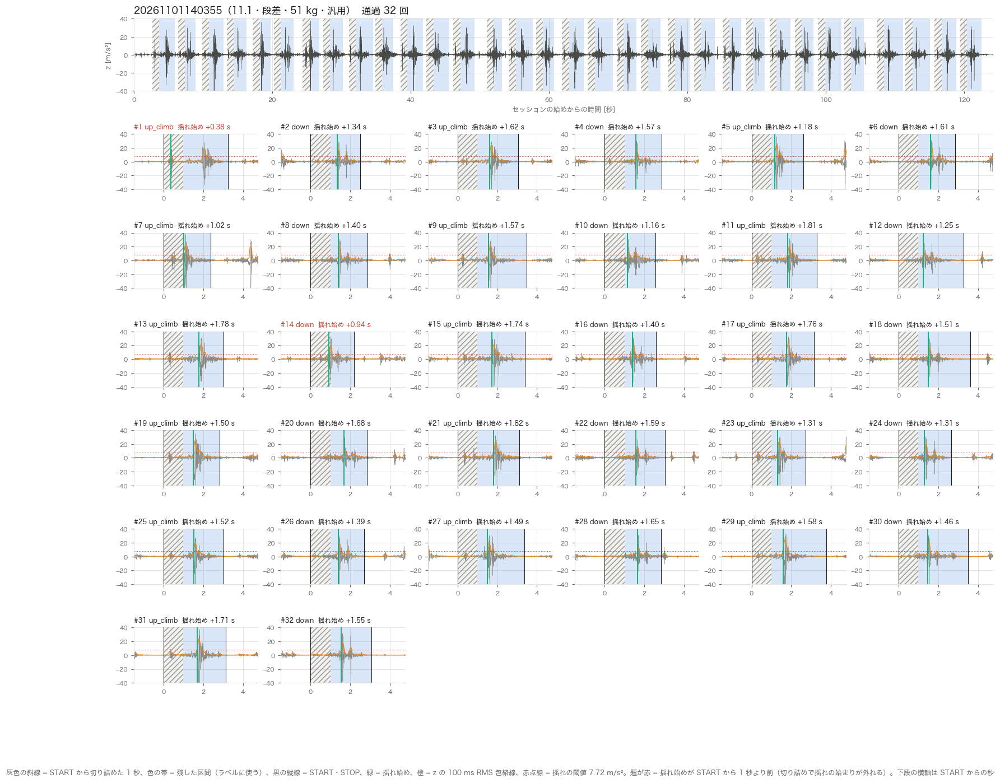

# ラベルの区間の始まりの決め方（一律 1 秒・揺れ始め・最大の加速度の前）

今は、ボタンの区間（START〜STOP）の START を、一律に 1 秒後ろにずらしている（shift_1。[ボタンのラグ](../2026-10-31/20261031_button_lag_eval.md) で、START から揺れ始めまでの中央値が約 1 秒だったため）。

この 1 秒が、波形の上で正しいかを、汎用の車椅子の全部の段差・凸凹のセッションで確かめた（1 章）。そのうえで、始まりの決め方を変えたときの精度を比べた（2 章）。

## サマリ

- **一律 1 秒は、平均では合っているが、合わない通過がある**。
  - 段差で |z| が一番大きい時刻（一番大きな衝撃）は、START から中央値 1.46 秒（10〜90% は 0.81〜2.23 秒）。
  - ただし、**201 回中 39 回は、一番大きな衝撃が切り詰めた 1 秒の中に入る**。この場合、残った区間には衝撃の後の揺れしか無いのに、段差のラベルが付く。
  - 39 回は特定のセッション・向きに集まる：`20261031144423`（33 回中 16 回）、`20261101142036` の down（11 回中 8 回）、`20261101140700` の up_climb（8 回中 4 回）。測る人が START を押した位置の違いと考えられる。
  - 凸凹は、START のときにはもう揺れている通過が 90 回中 26 回ある。切り詰めた 1 秒に本当の凸凹の揺れが入るが、こちらは間違ったラベルではなく、データを捨てているだけ。
- **段差の始まりを「一番大きな衝撃の 0.5 秒前」にすると、2.0 秒・1.0 秒のどちらでも一番よかった**（peak0.5。凸凹は shift_1 のまま）。

  | 条件 | 2.0 秒 flat / step / rough | 段差 ↔ 凸凹 | 1.0 秒 flat / step / rough | 段差 ↔ 凸凹 |
  | --- | --- | --- | --- | --- |
  | shift_1（今） | 0.96 / 0.95 / 0.91 | 39 | 0.91 / 0.87 / 0.83 | 181 |
  | **peak0.5** | **0.96 / 0.97 / 0.91** | **37** | **0.92 / 0.90 / 0.84** | **165** |

  - 段差のセッションごとでは、2.0 秒で 6 セッション中 4 で上がり、0 で下がった（2 は同じ）。1.0 秒では 4 で上がり、1 で下がった。
  - 段差の窓の数は、今とほぼ同じ（2.0 秒で 465 → 498、1.0 秒で 977 → 1004）。窓の数が大きく変わらないので、比べやすい。
- **前を 1 秒にする（peak1）と、2.0 秒ではほぼ同じだが、1.0 秒では悪くなる**（段差 ↔ 凸凹 181 → 205）。衝撃の 1 秒前は、まだ平らな道を走っている時間で、1.0 秒の窓ではその部分だけの窓にも段差のラベルが付くためと考えられる（確かめてはいない）。
- 通過ごとの「揺れ始め」（閾値を初めて超えた時刻）を始まりにしても、精度はほとんど変わらない。揺れ始めは、衝撃の前の小さな揺れで早めに決まることがあり、判定が不安定。
- **当面の候補は peak0.5**。根拠は 2 つ。
  - 一番大きな衝撃の時刻は、波形から一意に決まり、閾値などの決め方によらない。
  - 精度は今と同じか少し良く、衝撃を捨てない。
- 差は小さく、各設定 1 回の評価。区間を変えると評価に使う窓も変わる（3 章）。

## 0. 条件

| 項目 | 内容 |
| --- | --- |
| データ | 汎用の車椅子。1 章は 10.31・11.1 の、評価に使っている（use=yes）段差 8・凸凹 6 の 14 セッション（体重 51・68・69 kg、通過 291 回。取り消した通過を除く）。2 章は、そのうち 68〜69 kg の段差 6・凸凹 4 と、flat 6 の 16 セッション |
| 特徴量 | ゼミ資料 131-017 の core（暫定）：z_rms・z_kurt・h_std・h_crest・tilt_range |
| ラベル | 方針A（区間に窓の半分以上が重なる窓だけを使う。段差・凸凹のセッションで区間の外の窓は捨てる）。取り消した通過に重なる窓は捨てる |
| 窓 | 2.0・1.0 秒（窓幅の 1/4 ずつずらす） |
| モデル・評価 | SVM（標準化 + RBF、C=1.0、`class_weight="balanced"`）、セッション単位の LOGO（16 グループ） |
| 指標 | クラスごとの再現率、段差 ↔ 凸凹の取り違え（step → rough + rough → step の窓数） |

## 1. 波形で確かめる

### 1.1 図の見方





上：`20261031144423`（10.31、68 kg）。一番大きな衝撃が、切り詰めた 1 秒（灰色の斜線）に入る通過が多い。下：`20261101140355`（11.1、51 kg）。ほとんどの通過で、衝撃は残した区間（色の帯）に入る。

- 上段：セッション全体の上下の加速度 z。灰色の斜線 = START から切り詰めた 1 秒、色の帯 = 残した区間（段差は青、凸凹は橙）。
- 下段：通過ごとの拡大（START = 0 秒）。黒の縦線 = START・STOP、橙 = 揺れの大きさ（包絡線）、赤点線 = 閾値、緑 = 揺れ始め。揺れ始めが START から 1 秒より前の通過は、題を赤にした。
- 14 セッション全部の図は `data/analysis/20261104_label_shift_check/<session_id>.png`（git の管理外）。

### 1.2 「揺れ始め」の定義

[ボタンのラグ](../2026-10-31/20261031_button_lag_eval.md) と同じ考え方。

1. **揺れの大きさ（包絡線）**：上下の加速度 z（世界座標系の鉛直 − 重力）の、前後 0.1 秒の RMS。時刻ごとの「今どれくらい揺れているか」を表す 1 本の線。
2. **閾値**：flat 用に測ったセッション（ボタンを押していない、平らな道だけの測定。汎用の 8 セッション）の包絡線を全部の時刻について集め、下から 99% の値をとった（7.72 m/s²）。平らな道を走っていても、包絡線がこれを超えるのは時間の 1% だけ。
3. **揺れ始め**：START〜STOP の中で、包絡線が閾値を初めて超えた時刻。

弱いところ：

- 1 サンプル超えただけで決まるので、衝撃の前の小さな揺れで早めに決まることがある（例：`20261101140355` の #1 は +0.38 秒だが、衝撃は約 2 秒）。
- 閾値で変わる。10.31 のラグ分析は、10.31 の flat 2 セッションから出した 8.31 m/s² だった。揺れ始めが 1 秒より前の通過は、7.72 で 120 回、8.31 で 106 回、10 で 86 回（291 回中）。
- 凸凹の揺れは閾値に近い大きさなので、凸凹では不安定。
- START より前は見ていない。「+0.00 秒」は、START のときにはもう超えていたという意味。

このため、段差は、揺れ始めではなく、区間の中で |z| が一番大きい時刻（一番大きな衝撃）でも数えた。

### 1.3 結果

| | 段差（201 回） | 凸凹（90 回） |
| --- | --- | --- |
| START → 揺れ始め（中央値） | 1.15 秒 | 0.98 秒 |
| START → 一番大きな衝撃（中央値） | 1.46 秒（10〜90% は 0.81〜2.23 秒） | – |
| 一番大きな衝撃が、切り詰めた 1 秒に入る | **39 回** | – |
| START のときにはもう揺れている（揺れ始め < 0.5 秒） | – | **26 回** |

一番大きな衝撃が切り詰めた 1 秒に入る通過（段差、セッション・向きごと。他は 0〜3 回）：

| セッション | 向き | 回数 |
| --- | --- | --- |
| `20261031144423`（10.31、68 kg） | down | 15 回中 10 回 |
| `20261031144423` | up_climb・up_stop | 18 回中 6 回 |
| `20261101142036`（11.1、51 kg） | down | 11 回中 8 回 |
| `20261101140700`（11.1、69 kg） | up_climb | 8 回中 4 回 |

- 一律 1 秒が合わないのは、セッション（日・測る人の押し方）と、段差の向きによる。同じセッションの中でも、down と up_climb で START を押す位置が違うことがある（`20261101142036`：揺れ始めの中央値は down 0.54 秒、up_climb 1.44 秒）。
- 凸凹で START のときにはもう揺れている通過が多いのは、`20261031145017`（12 回中 7 回）と `20261101142926`（16 回中 6 回）。
- **STOP の側にもずれがある**。揺れの終わりから STOP まで、セッションの中央値で 0.5〜1.2 秒。今は切り詰めていない。

## 2. 始まりの決め方を変えた精度

### 2.1 条件

| 名前 | 段差の区間 | 凸凹の区間 |
| --- | --- | --- |
| button | START〜STOP | 同じ |
| shift_1（今） | START + 1 秒〜STOP | 同じ |
| onset | 揺れ始め〜STOP（閾値 7.72・8.31） | 同じ |
| activity | 揺れ始め〜揺れの終わり（同） | 同じ |
| peak1 | 一番大きな衝撃（\|z\| が最大）の 1 秒前〜STOP | shift_1 |
| peak0.5 | 一番大きな衝撃の 0.5 秒前〜STOP | shift_1 |

peak1・peak0.5 は、START より前にはみ出してもよいとした。START で止める版（peak1c・peak0.5c）もほぼ同じ結果（peak1c 0.96 / 0.96 / 0.92、peak0.5c は peak0.5 と同じ）。揺れ始めが無い通過は、onset・activity では区間にしない（4 回）。

### 2.2 結果（SVM、core）

| 条件 | 2.0 秒 flat / step / rough | 段差 ↔ 凸凹 | 窓 step / rough | 1.0 秒 flat / step / rough | 段差 ↔ 凸凹 | 窓 step / rough |
| --- | --- | --- | --- | --- | --- | --- |
| button | 0.95 / 0.92 / 0.90 | 97 | 830 / 534 | 0.91 / 0.85 / 0.81 | 338 | 1575 / 1053 |
| **shift_1（今）** | 0.96 / 0.95 / 0.91 | 39 | 465 / 408 | 0.91 / 0.87 / 0.83 | 181 | 977 / 813 |
| onset@7.72 | 0.95 / 0.97 / 0.91 | 32 | 440 / 374 | 0.92 / 0.88 / 0.82 | 177 | 902 / 742 |
| onset@8.31 | 0.95 / 0.97 / 0.91 | 31 | 426 / 358 | 0.92 / 0.89 / 0.82 | 169 | 884 / 712 |
| activity@7.72 | 0.95 / 0.76 / 0.93 | 18 | 58 / 235 | 0.95 / 0.86 / 0.84 | 108 | 308 / 481 |
| peak1 | 0.96 / 0.96 / 0.91 | 43 | 680 / 408 | 0.91 / 0.87 / 0.83 | 205 | 1294 / 813 |
| **peak0.5** | **0.96 / 0.97 / 0.91** | **37** | 498 / 408 | **0.92 / 0.90 / 0.84** | **165** | 1004 / 813 |

段差のセッションごとの再現率（shift_1 → peak1 → peak0.5）：

| セッション | 2.0 秒 | 1.0 秒 |
| --- | --- | --- |
| 20261031142102 | 0.93 → 0.97 → 0.95 | 0.92 → 0.90 → 0.91 |
| 20261031144423 | 0.99 → 0.99 → 1.00 | 0.91 → 0.89 → 0.96 |
| 20261031145759 | 0.97 → 0.95 → 0.98 | 0.92 → 0.87 → 0.91 |
| 20261031152930 | 0.91 → 0.94 → 0.94 | 0.83 → 0.86 → 0.90 |
| 20261101140700 | 0.97 → 0.98 → 0.97 | 0.88 → 0.92 → 0.90 |
| 20261101142339 | 0.94 → 0.95 → 0.94 | 0.80 → 0.76 → 0.81 |

- **切り詰めること自体は効く**：button → shift_1 で、段差 ↔ 凸凹は 97 → 39 窓（2.0 秒）。START 直後の、まだ平らな道を走っている部分を外したため。
- **peak0.5 は、2.0 秒・1.0 秒の両方で、shift_1 と同じか良い**。段差の再現率は 0.95 → 0.97（2.0 秒）、0.87 → 0.90（1.0 秒）。1.0 秒では、段差 ↔ 凸凹も 181 → 165 窓。凸凹の区間は同じ（shift_1）なのに凸凹の再現率も少し上がるのは、凸凹と間違えやすい「衝撃の後の揺れだけの段差の窓」が、学習から減ったためと考えられる（確かめてはいない）。
- 1.0 秒で一番上がったのは、一番大きな衝撃が切り詰めた 1 秒に入る通過が多かった `20261031144423`（0.91 → 0.96）。1 章の問題が直った形。
- **peak1 は、1.0 秒で悪くなる**（段差 ↔ 凸凹 181 → 205、段差の 6 セッション中 4 で下がる）。衝撃の 1 秒前は、まだ平らな道を走っている時間を含む。
- **onset（揺れ始め）は、shift_1 とほとんど変わらない**。2.0 秒の段差・凸凹のセッションごとでは、上がった 4・下がった 4・同じ 2。
- **activity は、2.0 秒では使えない**。段差の区間が短くなり、ラベルの付く段差の窓が 58 しか残らない。

## 3. 考察

- 一律 1 秒は、測る人の押し方（日・セッション・向き）の違いを吸収できない。一番大きな衝撃を基準にすると、押し方によらず、段差の本体を区間に入れられる。
- 衝撃の前は 0.5 秒がよい。段差の衝撃は、前輪と後輪で 2 回ある（up_climb・down）ので、一番大きな衝撃が 2 回目のときは、1 回目が 0.5 秒より前にある可能性がある（確かめてはいない）。そのときは、STOP までの区間が 1 回目を含まない。前を 0.5 秒から少しずつ変える評価や、「閾値を超える衝撃のうち最初のもの」を基準にする方法は、まだ試していない。
- 区間を変えると、評価に使う窓も変わる。peak0.5 は、段差の窓の数が shift_1 とほぼ同じ（+7%・+3%）なので、比べやすい。peak1 は窓が 1.3〜1.5 倍に増えていて、数字だけでは比べにくい。
- 凸凹は、今回は shift_1 のまま。凸凹は START のときにはもう揺れている通過が多い（26 / 90 回）ので、切り詰めないほうが、データを捨てずに済む可能性がある（未評価）。STOP の側（揺れの終わりから STOP まで 0.5〜1.2 秒）も、まだ手を付けていない。
- ゼミの先生の案（区間の前 1 秒から採用する）とは、まだ比べていない。

## 4. 限界

- 各設定 1 回の評価。差は 0.01〜0.03 で、セッション数（段差 6・凸凹 4）も少ない。
- 「一番大きな衝撃」は |z| の最大の 1 点で決めている。区間の中にほかの大きな揺れ（漕ぎ出し、継ぎ目など）があると、ずれる。
- 2 章は 68〜69 kg の人だけ。51 kg の人の通過は 1 章でだけ見た。
- 0.5 秒・1 秒という前の幅は、この 16 セッションで比べて選んだ。

## 5. 再現方法

```bash
python -m src.experiments.e20261104_label_shift_check   # 1 章の図と、通過ごとの揺れ始め
python -m src.experiments.e20261104_onset_label_eval    # 2 章の精度
```

出力：

- `data/analysis/20261104_label_shift_check/`：`<session_id>.png`（14 枚）、`passes.csv`、`summary.csv`
- `data/analysis/20261104_onset_label_eval/`：`results.csv`、`by_session.csv`
- 1 章の一番大きな衝撃の集計と、2.2 のセッションごとの表は、その場で集計した。
