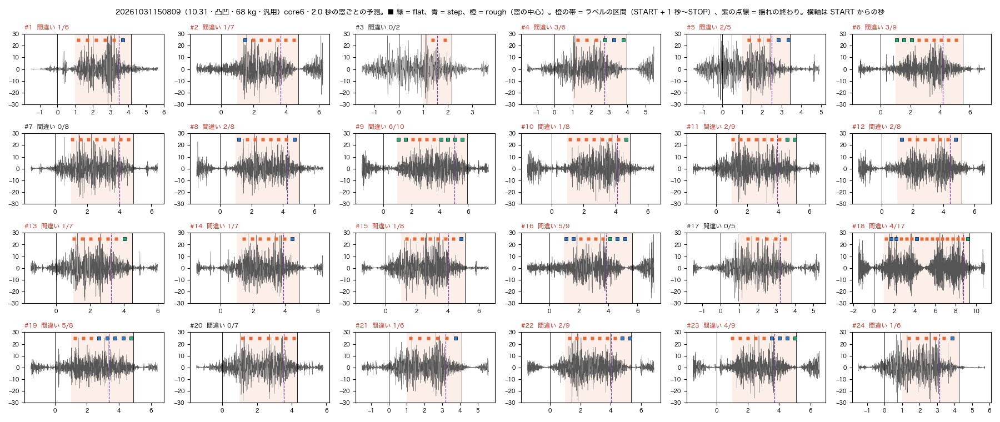

# core6（core + h_burst_ratio）と、除いていた凸凹 20261031150809 を入れ直した評価

[rough の再現率が 0.91 にとどまる原因](20261105_rough_error_analysis.md) を受けて、2 つを評価した。

- core に `h_burst_ratio` を足した **core6（暫定）**。
- 10.31 に測る人の判断で除いた凸凹 `20261031150809` を入れ直す。除いた理由は「凸凹がゆるく、単発の衝撃が混ざる」（`configs/sessions/10.31.csv`）。

設定ファイル（`use=no`）は変えず、評価のスクリプトの中でだけ足した。

## サマリ

- **150809 を入れると、rough は 0.92 → 0.87 に下がる**（core6・2.0 秒）。150809 自体の再現率は 0.74 で、凸凹の窓の 31%（592 窓中 184 窓）を占める。
- **core6 は、150809 を入れても core より良いが、150809 そのものは直らない**。
  - 17 セッションで、core 0.94 / 0.94 / 0.85 → core6 0.94 / 0.94 / 0.87。段差 ↔ 凸凹は 76 → 65 窓。
  - 150809 は 0.734 → 0.739（2.0 秒）、0.618 → 0.596（1.0 秒）。
- **150809 の間違いの 6 割は、ラベルの区間の終わりの、揺れが終わった後の窓**（48 窓中 30 窓）。通過の終わり 20% の窓は、32 窓中 23 窓を間違える。143126 と同じ STOP 側のラベルのずれで、もっとひどい。
- **ずれを除いても、150809 は 0.86〜0.87**（どちらのラベルでも凸凹になる窓だけでテスト）。ほかの凸凹は 0.95〜1.00。残りは路面の性質。
  - 凸凹の中で、傾きが一番大きく（90 パーセンタイル 5.8 度）、衝撃が一番突き出ている（h_burst_ratio の中央値 3.76。ほかの凸凹は 2.7〜3.3）。
  - 測る人のメモ「単発の衝撃が混ざる」と合う。core6 で足した h_burst_ratio 自体が段差の側に寄るので、直らない。
- **150809 を学習に入れると、粗い flat と、段差の 1 セッションが下がる**。
  - flat：`20261031150048` 0.94 → 0.89、`20261101143455` 0.95 → 0.90。
  - 段差：`20261031152930` 0.94 → 0.88。
  - 「ゆるい凸凹」と「粗い舗装の flat」が、今の特徴量では重なっている。
- **判断**：除いた理由（ゆるい・単発の衝撃が混ざる）は路面の性質で、測定の失敗ではない。実際の道にもある凸凹なので、評価には入れるのが筋。ただし、入れるなら次の 2 つが要る。
  - STOP 側のラベルの決め方を、全部の凸凹のセッションで同じ規則にする。
  - ゆるい凸凹と粗い flat を分ける手がかりを探す。

## 0. 条件

[rough の再現率が 0.91 にとどまる原因](20261105_rough_error_analysis.md) と同じ。

- データ：汎用・68〜69 kg の 16 セッション。17 セッションの評価では、`20261031150809`（10.31、凸凹、68 kg、24 回の通過）を足した。
- ラベル：方針A、START を 1 秒ずらす。
- モデル・評価：SVM、セッション単位の LOGO。
- 窓：2.0 秒・1.0 秒。
- 「揺れの終わりまで」は、凸凹の区間の終わりを、z の包絡線が 7.72 m/s² を最後に超えた時刻にしたラベル。

## 1. 結果

### 全体（flat / step / rough、段差 ↔ 凸凹の取り違え、150809 の再現率）

| 窓 | セッション | ラベル | core | core6 | 150809（core → core6） |
| --- | --- | --- | --- | --- | --- |
| 2.0 秒 | 16 | 今 | 0.96 / 0.95 / 0.91（39） | 0.96 / 0.97 / 0.92（25） | – |
| 2.0 秒 | **17** | 今 | 0.94 / 0.94 / 0.85（76） | **0.94 / 0.94 / 0.87（65）** | 0.73 → 0.74 |
| 2.0 秒 | 17 | 揺れの終わりまで | 0.94 / 0.95 / 0.91（41） | 0.94 / 0.96 / 0.92（31） | 0.82 → 0.84 |
| 2.0 秒 | 17 | 共通の窓 | 0.94 / 0.94 / 0.92（47） | 0.94 / 0.94 / 0.93（38） | 0.86 → 0.87 |
| 1.0 秒 | 16 | 今 | 0.91 / 0.87 / 0.83（181） | 0.91 / 0.89 / 0.86（138） | – |
| 1.0 秒 | **17** | 今 | 0.90 / 0.86 / 0.78（274） | **0.90 / 0.85 / 0.79（262）** | 0.62 → 0.60 |
| 1.0 秒 | 17 | 揺れの終わりまで | 0.91 / 0.86 / 0.84（171） | 0.91 / 0.88 / 0.86（148） | 0.76 → 0.76 |
| 1.0 秒 | 17 | 共通の窓 | 0.90 / 0.86 / 0.85（194） | 0.90 / 0.85 / 0.87（184） | 0.74 → 0.73 |

（共通の窓 = 今のラベルでも、揺れの終わりまでのラベルでも同じラベルになる窓だけでテスト。学習は今のラベル。凸凹の窓は 2.0 秒で 592（今）・391（揺れの終わりまで・共通）。）

- 17 セッションでも、core6 は core より段差 ↔ 凸凹が少ない（2.0 秒で 76 → 65、1.0 秒で 274 → 262）。ただし、16 セッションのときより効果は小さい。1.0 秒では step が 0.86 → 0.85 と少し下がる。

### 凸凹のセッションごと（17 セッション、2.0 秒、core → core6）

| セッション | 再現率 | → flat | → step |
| --- | --- | --- | --- |
| 20261031143004 | 1.00 → 1.00 | 0 → 0 | 0 → 0 |
| 20261031145017 | 0.95 → 0.95 | 0 → 0 | 4 → 4 |
| **20261031150809** | **0.73 → 0.74** | 21 → 19 | 28 → 29 |
| 20261101141730 | 0.94 → 0.97 | 3 → 2 | 4 → 1 |
| 20261101143126 | 0.77 → 0.80 | 12 → 14 | 16 → 10 |

### 150809 を足したときの、flat・段差のセッション（2.0 秒、core6、16 → 17 セッション）

| クラス | セッション | 16 | 17 |
| --- | --- | --- | --- |
| flat | 20261031150048（揺れの大きい flat） | 0.94 | 0.89 |
| flat | 20261101143455 | 0.95 | 0.90 |
| flat | ほかの 4 セッション | 0.91〜1.00 | 0.93〜1.00 |
| step | 20261031152930 | 0.94 | 0.88 |
| step | ほかの 5 セッション | 0.93〜1.00 | 0.94〜1.00 |

### 体重のテスト（2.0 秒）

| テスト | core | core6 | 150809（core → core6） |
| --- | --- | --- | --- |
| 68〜69 kg（17）→ 51 kg | 0.98 / 0.98 / 0.98（5） | 0.98 / 0.97 / 0.98（6） | – |
| 51 kg → 68〜69 kg（17） | 0.96 / 0.97 / 0.83（83） | 0.96 / 0.98 / 0.84（71） | 0.70 → 0.71 |

## 2. 150809 の性質



通過ごとの z と、窓ごとの予測（窓の中心に印。緑 = flat、青 = step、橙 = rough）。橙の帯 = ラベルの区間、紫の点線 = 揺れの終わり。

凸凹のセッションの比較（2.0 秒、ラベル付きの窓の中央値）：

| セッション | 体重 | 窓 | z_rms | 傾きの範囲 中央値 / 90% [度] | h_burst_ratio | 揺れの終わりより後の静かな窓 | 揺れの終わり → STOP |
| --- | --- | --- | --- | --- | --- | --- | --- |
| 20261031143004 | 68 | 87 | 5.86 | 3.07 / 4.27 | 2.98 | 22 | 0.90 秒 |
| 20261031145017 | 68 | 87 | 7.60 | 3.65 / 5.35 | 2.93 | 13 | 1.04 秒 |
| **20261031150809** | 68 | **184** | 7.11 | 3.67 / **5.80** | **3.76** | 20 | 0.95 秒 |
| 20261101141730 | 69 | 113 | 5.67 | 2.61 / 3.38 | 2.98 | 25 | 1.08 秒 |
| 20261101143126 | 69 | 121 | 5.09 | 2.96 / 4.88 | 3.28 | 52 | 1.24 秒 |
| 20261101141512 | 51 | 129 | 8.47 | 3.18 / 4.19 | 2.68 | 2 | 0.52 秒 |
| 20261101142926 | 51 | 103 | 8.92 | 3.94 / 5.16 | 2.94 | 9 | 0.63 秒 |

（静かな窓 = z_rms が flat の窓の 90 パーセンタイルより小さい窓。揺れの終わり → STOP は通過ごとの中央値。）

通過の中の位置ごとの間違い（17 セッション、core6、2.0 秒。0 = START + 1 秒、1 = STOP）：

| セッション | 始め 20% | 中 60% | 終わり 20% | 揺れの終わりより後の間違い |
| --- | --- | --- | --- | --- |
| 20261031150809 | 38 窓中 11 | 114 窓中 14 | **32 窓中 23** | 48 窓中 30 |
| 20261101143126 | 21 窓中 6 | 76 窓中 8 | 24 窓中 10 | 24 窓中 18 |

- 150809 は、揺れの大きさ（z_rms 7.11）はほかの凸凹と同じくらい。違うのは、傾きの大きさと、衝撃の突き出し方。
- 揺れの終わりより後の静かな窓（20）は、ほかの凸凹（13〜52）と比べて多くない。それでも終わり 20% の間違いが多いのは、揺れが小さくなりながら単発の衝撃が混ざる部分で、静かな窓だけでなく、段差に見える窓（→ step）が多いため。
- 通過の前後（START より前・STOP より後）にも揺れが続いている通過がある（#3・#9・#18 など）。凸凹の路面が、ボタンで区切った区間より長く続いている可能性がある（未確認）。

### 2.1 通過の端で間違いが多い理由と、その確認

**なぜ端で間違えやすいか（見立て）**

- 方針A では、ラベルの区間（START + 1 秒〜STOP）に窓の半分以上が重なる窓に、ラベルが付く。窓は 2.0 秒、凸凹の通過は 3〜5 秒なので、通過の端では、窓の半分近くが区間の外の走行になる。
- 後ろ：揺れが終わってから STOP を押すまでに、約 1 秒の静かな走行がある（150809 は中央値 0.95 秒、143126 は 1.24 秒）。窓の半分が静かなので flat に見える。揺れが小さくなる終わりぎわに単発の衝撃が混ざると step にも見える。
- 前：START から 1 秒切り詰めても、揺れが立ち上がる前の窓が残る。
- 中ほどは、窓の全体が凸凹の揺れなので、間違いが少ない。

**確認：窓を「区間に全部入る窓」と「端の窓（半分以上 100% 未満が重なる窓）」に分ける**（`src/experiments/e20261105_edge_windows.py`。学習は今のラベル・全部の窓のまま。テストの窓だけを分けた。SVM、17 セッション）

| 窓 | 特徴量 | 凸凹：全部入る窓 | 凸凹：端の窓 | 段差：全部入る窓 | 段差：端の窓 |
| --- | --- | --- | --- | --- | --- |
| 2.0 秒 | core | 0.900（259 窓） | 0.814（333 窓） | 1.000（41 窓） | 0.932（424 窓） |
| 2.0 秒 | core6 | 0.915（259 窓） | 0.829（333 窓） | 1.000（41 窓） | 0.939（424 窓） |
| 1.0 秒 | core | 0.810（846 窓） | 0.699（336 窓） | 0.883（412 窓） | 0.842（565 窓） |
| 1.0 秒 | core6 | 0.839（846 窓） | 0.664（336 窓） | 0.883（412 窓） | 0.832（565 窓） |

凸凹の 2 セッション（17 セッション、core6、凸凹の窓）：

| セッション | 窓 | 全部入る窓 | 端の窓 |
| --- | --- | --- | --- |
| 20261031150809 | 2.0 秒 | 0.867（90 窓） | **0.617（94 窓）** |
| 20261031150809 | 1.0 秒 | 0.707（273 窓） | **0.281（96 窓）** |
| 20261101143126 | 2.0 秒 | 0.837（49 窓） | 0.778（72 窓） |
| 20261101143126 | 1.0 秒 | 0.761（163 窓） | 0.750（72 窓） |

- **端の窓の方が、再現率が低い**（凸凹で 0.08〜0.16 低い。2.0 秒・core6 は 0.915 と 0.829）。見立てと合う。
- **150809 は端の影響が大きい**。2.0 秒で全部入る窓は 0.87、端の窓は 0.62。1.0 秒の端の窓は 0.28 まで下がる。
- **143126 は端の影響が小さい**。全部入る窓でも 0.84（2.0 秒）・0.76（1.0 秒）と低い。143126 の間違いは、端だけでなく、中ほどの窓にもある（場所 D の大きめの凸で step に見える窓など。[前のメモ](20261105_rough_error_analysis.md) の 2 章）。
- **端を除いても、150809・143126 は、ほかの凸凹（0.95〜1.00）より低い**。端のずれだけでは説明できず、路面の性質（2 章の表）も残っている。
- **「全部入る窓」でも、区間の終わりの静かな部分に入る窓がある**。区間は STOP までで、STOP の前の約 1 秒は静かなため。端の影響を取り切れてはいないので、差は小さめに出ている可能性がある。
- 段差は、全部入る窓が 41 窓しかない（段差の通過は区間が短く、2.0 秒の窓が全部入りにくい）。段差の端の影響は、この方法では判断できない。
- 端の窓の間違いを減らすには、ラベルの区間を実際の揺れに合わせる必要がある（STOP 側のラベルの決め方。次の測定で、凸凹を抜けたらすぐ STOP を押す）。窓の幅を短くすると端の窓は減るが、1.0 秒は全体の再現率が低い。

## 3. 考察

- **150809 を入れるべきか**
  - 除いた理由（ゆるい・単発の衝撃が混ざる）は路面の性質で、測定の失敗ではない。[前のメモ](20261105_rough_error_analysis.md) の 3 章と同じ基準なら、入れるべき。除くと、評価が実際の道より甘くなる。
  - ただし、入れると rough の数字は 0.92 → 0.87 に下がり、その半分以上はラベルのずれ（揺れが終わった後の窓）による。ラベルの決め方を直さないまま入れると、「モデルが弱い」のか「ラベルがずれている」のかが分からなくなる。
- **残る課題は 2 つ**
  1. **STOP 側のラベル**：揺れの終わりまでにすると、17 セッション・core6 で 0.94 / 0.96 / 0.92。ただし、[前のメモ](20261105_rough_error_analysis.md) の 5 章のとおり、これは評価の定義を変えるだけ。次の測定で、凸凹を抜けたらすぐ STOP を押す方が確実。
  2. **ゆるい凸凹と粗い flat の重なり**：150809 を学習に入れると、粗い flat（150048・143455）が凸凹と答えられやすくなる。flat と凸凹を分ける手がかり（z_rms などの揺れの大きさ）が、ゆるい凸凹では弱いため。体重・車椅子に強い 8〜16 Hz の帯域の特徴量（[周波数帯の特徴量](../2026-11-01/20261101_band_features.md)）や、傾き方の違いが候補だが、まだ試していない。
- **core6 について**：150809 を入れても、全体では core より良い（段差 ↔ 凸凹が減る）。150809 の「衝撃の混ざる凸凹」には効かないが、悪くもしない（0.73 → 0.74）。

## 4. 限界

- 150809 は 1 セッション（24 回の通過）で、凸凹の窓の 3 割を占める。1 セッションの性質が、全体の数字を大きく動かす。
- 「揺れの終わり」は z の包絡線と閾値で決めた定義で、本当に凸凹の路面が終わった時刻かは分からない。
- 各設定 1 回の評価。

## 5. 再現方法

```bash
python -m src.experiments.e20261105_core6_eval
python -m src.experiments.e20261105_edge_windows   # 2.1 節（端の窓）。出力は data/analysis/20261105_edge_windows/
```

出力は `data/analysis/20261105_core6_eval/`（`results.csv`、`rough_by_session.csv`、`transfer.csv`、`rough_sessions.csv`、`pred_20261031150809.png`）。図は `docs/knowledge/2026-11-05/images/` にも保存する。
