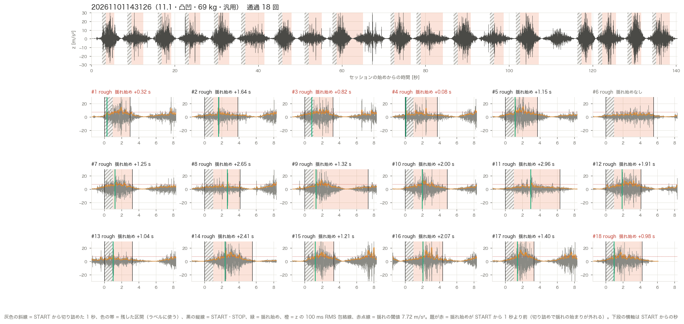

# 凸凹のセッション 20261101143126 を通過ごとに確かめる

[rough の再現率が 0.91 にとどまる原因](../2026-11-05/20261105_rough_error_analysis.md)（11.5）で、rough の間違いの 73% が集まっていた凸凹のセッション `20261101143126`（11.1、凸凹の場所 D、69 kg）を、通過ごとに確かめた。

- どの通過で間違えているか（1 章）
- 間違いの多い通過 #9・#11 を除くと、精度がどれだけ変わるか（2 章）
- GPS で、同じ場所を往復していたか（3 章）
- 遅く押したことが原因ではないか（4 章）

## サマリ

- **間違い 27 窓のうち 9 窓が #9**（#9 の窓 13 個中 9 個）。次は #11 の 3 窓。ほかは 0〜2 窓ずつ。
  - #9 は、flat への間違い 4 窓（区間の後半）と、step への間違い 5 窓の両方がある。
  - #11 は、flat への間違い 3 窓で、すべて区間の終わり。
- **#9・#11 を除くと、rough は 0.91 → 0.93（2.0 秒）、0.83 → 0.85（1.0 秒）**。143126 の再現率は 0.78 → 0.85。
  - テストだけ除いても、学習からも除いても、ほぼ同じ。上がった分は、除いた窓の間違いが消えた分。
  - 除いても 143126 は 0.85 で、ほかの凸凹（0.94〜1.00）に届かない。残りは、傾きの大きい窓（#5・#15・#17 など）の step への間違い。
  - **#9・#11 は、間違いを見てから選んだ通過**。除いた精度をモデルの性能としては使わない。間違いの内訳（どれだけが STOP 側のずれによるか）として使う。
- **GPS では、凸凹の上をおおむね往復している**。通過の中で位置が増える通過と減る通過が、交互に近い形で出る。ただし、GPS の誤差（約 4.6 m）が走った範囲（約 10 m）に比べて大きく、はっきりとは言えない。
- **#9・#11 は遅くなかった**。速度は 0.87・0.82 m/s で、ほかの通過（中央値 0.83 m/s）と同じくらい。区間が長い（7.35・6.34 秒）のは、STOP が遅れた（揺れの終わりから 4.58・3.20 秒）ため。
- セッション全体では、同じ場所の 51 kg の人（`20261101142926`、1.10 m/s）より約 2 割遅い。ただし、体重も違うので、速度の影響とは分けられない。

## 0. 条件

[rough の再現率が 0.91 にとどまる原因](../2026-11-05/20261105_rough_error_analysis.md) と同じ。

| 項目 | 内容 |
| --- | --- |
| データ | 汎用の車椅子・68〜69 kg の 16 セッション（10.31・11.1。step 6・rough 4・flat 6） |
| ラベル | 方針A、START を 1 秒後ろにずらす（shift_1） |
| 特徴量 | core（ゼミ資料 131-017）：z_rms・z_kurt・h_std・h_crest・tilt_range |
| モデル・評価 | SVM（標準化 + RBF、C=1.0、`class_weight="balanced"`）、セッション単位の LOGO。窓 2.0 秒（主）・1.0 秒 |
| 速度 | `acc.csv` の `speedMps`（GPS の速度。約 1 秒ごとに更新）の、ボタンの区間の中の中央値 |

## 1. 波形と、通過ごとの間違い



- 上段：セッション全体の上下の加速度 z と、ボタンの区間（灰色の斜線 = START から切り詰めた 1 秒、赤 = ラベルに使う区間）。
- 下段：通過ごとの拡大（START = 0 秒）。黒の縦線 = START・STOP、橙 = z の 100 ms RMS 包絡線、赤点線 = 揺れの閾値 7.72 m/s²、緑 = 揺れ始め。題が赤 = 揺れ始めが START から 1 秒より前。
- 図は [ラベルの区間の始まりの決め方](../2026-11-04/20261104_label_interval_eval.md)（11.4）で作ったもの（`e20261104_label_shift_check`）。

通過ごとの間違い（core、2.0 秒）：

| 通過 | 窓 | 間違い | → flat | → step | tilt_range の中央値 [度] |
| --- | --- | --- | --- | --- | --- |
| **#9** | 13 | **9** | 4 | 5 | 2.3 |
| #11 | 11 | 3 | 3 | 0 | 2.6 |
| #5 | 6 | 2 | 0 | 2 | 4.6 |
| #6 | 9 | 2 | 2 | 0 | 2.3 |
| #15 | 5 | 2 | 0 | 2 | 5.1 |
| #17 | 5 | 2 | 0 | 2 | 5.2 |
| #2・#3・#4・#10・#13・#14・#16 | 5〜9 | 各 1 | | | |
| #1・#7・#8・#12・#18 | 4〜7 | 0 | | | |

間違えた窓の、通過の中の位置（0 = START + 1 秒、1 = STOP）：

- **flat への間違い**
  - #9 は 0.44〜0.91、#11 は 0.86〜0.96（1 窓だけ 0.02）。区間の後半から終わり。波形でも、#9 は 5 秒ごろに揺れが収まるが、STOP は 7.5 秒ごろ。
  - #6 は 0.02・0.13 で、区間の始まり。#6 は揺れが一度も閾値を超えない、揺れの弱い通過。
- **step への間違い**
  - #2・#3・#5・#15・#17 は、窓の tilt_range が 3.7〜5.2 度と大きい。場所 D の大きめの凸によるもので、11.5 の説明と合う。
  - #9 の 5 窓のうち、始めの 2 窓は傾きが大きい（5.4〜5.5 度）。残りの 3 窓（位置 0.52〜0.67）は傾きが小さい（1.4〜1.9 度）のに step と予測された。揺れが収まっていく途中の窓が、段差の「衝撃の後の揺れ」に似て見えている可能性がある（確かめてはいない）。

## 2. #9・#11 を除いた評価

| 窓 | 条件 | flat / step / rough | 段差 ↔ 凸凹 | rough → flat | rough → step | 143126 の再現率（窓） |
| --- | --- | --- | --- | --- | --- | --- |
| 2.0 秒 | そのまま | 0.956 / 0.948 / 0.909 | 39 | 15 | 22 | 0.777（121） |
| 2.0 秒 | テストだけ除く | 0.956 / 0.948 / **0.935** | 34 | 8 | 17 | 0.845（97） |
| 2.0 秒 | 学習・テストとも除く | 0.956 / 0.946 / **0.932** | 32 | 9 | 17 | 0.845（97） |
| 1.0 秒 | そのまま | 0.911 / 0.873 / 0.828 | 181 | 44 | 96 | 0.681（235） |
| 1.0 秒 | テストだけ除く | 0.911 / 0.873 / **0.854** | 165 | 32 | 80 | 0.750（188） |
| 1.0 秒 | 学習・テストとも除く | 0.911 / 0.870 / **0.851** | 166 | 32 | 82 | 0.750（188） |

除いた窓は、2.0 秒で 24、1.0 秒で 47。

- テストだけ除いても、学習・テストとも除いても、ほぼ同じ。#9・#11 を学習に入れても、ほかのセッションのモデルは悪くなっていない。上がった分は、除いた窓の間違いがそのまま消えた分。
- 除いた後も、143126 は 0.85（2.0 秒）。残りの間違いは、主に傾きの大きい窓の step への間違い。このセッションが低いのは、#9・#11 のラベルのずれと、場所 D の路面の性質の両方による。
- 通過を選ばずに、全部の凸凹の通過の STOP 側を同じ規則で直した評価は、11.5 の「揺れの終わりまで」のラベル（2.0 秒で rough 0.945）。

## 3. GPS で見た走り方

- 位置の中央値は `35.000093, 137.072013`（[Google マップ](https://www.google.com/maps?q=35.000093,137.072013)）。走った範囲は、南北に約 9 m、東西に約 11 m。GPS の精度は 4.6〜9.1 m（中央値 4.6 m）。
- 位置を、一番よく動いた向き（北西〜南東）の 1 本の軸に並べた。
  - 通過の中で位置が増える通過（#2・#8・#11・#16・#18 など）と、減る通過（#5・#10・#12・#14・#15・#17 など）が、交互に近い形で出る。凸凹の上を往復しながら記録したと考えられる。
- 波形図の上段で、どの区間にも入っていない大きな揺れが 2 か所ある（60〜70 秒ごろ、110〜115 秒ごろ）。
  - どちらも、GPS の位置が大きく動いている時間と重なる（66〜71 秒で −1 → +5 m、109〜116 秒で −1.6 → +1.0 m）。
  - ボタンを押さずに凸凹の上を戻った時間の可能性がある。ほかの区間の間は揺れが小さい理由は分からない（推測）。
- 位置の中心が、前半（−4〜−1 m）と後半（+3〜+5 m）でずれている。GPS のずれか、走った場所が変わったかは区別できない。

## 4. 速度

測る人の印象として、「被験者に押してもらったので速度が少し遅く、それで揺れが小さくなったのでは」という仮説があった。凸凹の上をゆっくり走ると揺れが小さくなり、flat に近づく可能性がある（11.5 の 5 章）。

通過ごと（143126）：

| 通過 | 速度 [m/s] | ボタンの区間 [秒] | 揺れの終わり → STOP [秒] |
| --- | --- | --- | --- |
| #9 | 0.87 | 7.35 | **4.58** |
| #11 | 0.82 | 6.34 | **3.20** |
| ほかの 16 回（中央値） | 0.83 | 3.8 | 0.9 |

- #9・#11 の速度は、ほかの通過と同じくらい。区間が長いのは、遅く通ったためではなく、STOP が遅れたため。

セッションごと（凸凹）：

| セッション | 日 | 体重 [kg] | 速度の中央値 [m/s] | 揺れの終わり → STOP [秒] | 速度が 0 の時間の割合 |
| --- | --- | --- | --- | --- | --- |
| 20261031143004 | 10.31 | 68 | （0.00） | 0.90 | 0.61 |
| 20261031145017 | 10.31 | 68 | 0.78 | 1.04 | 0.35 |
| 20261101141512 | 11.1 | 51 | （0.00） | 0.52 | 0.77 |
| 20261101141730 | 11.1 | 69 | （0.00） | 1.08 | 0.73 |
| 20261101142926 | 11.1（場所 D） | 51 | 1.10 | 0.63 | 0.13 |
| **20261101143126** | 11.1（場所 D） | 69 | **0.84** | **1.24** | 0.12 |

- 3 セッションは、速度が 0 の時間が 6〜8 割で、GPS が速度を出せていない。比べられるのは 3 セッションだけ。
- 同じ場所 D では、143126（0.84 m/s）が 142926（1.10 m/s）より約 2 割遅い。ただし、体重（69 kg・51 kg）も違う。11.1 の [体重の違う人への汎化](../2026-11-01/20261101_weight_transfer.md) では、51 kg の人は凸凹の揺れが約 1.45 倍大きかった。この差が、体重によるのか速度によるのかは、このデータでは分けられない。

## 5. 考察と次にやること

- 143126 の rough の間違いは、次の 2 つでほぼ説明できる。
  - STOP 側のずれ（#9・#11 に集中）
  - 場所 D の傾きやすい路面（複数の通過に少しずつ）
- 速度が遅かったことは、#9・#11 の原因ではない。セッション全体で遅かった影響は、否定も肯定もできない。
- 次の測定でやること：
  - 凸凹を抜けたらすぐ STOP を押す。または、凸凹の区間の終わりに目印を置く。
  - 速度を測る。GPS の速度は 1 秒ごと・誤差数 m で、3〜7 秒の通過には粗い。例えば、凸凹の長さを測っておき、通過にかかった時間から速度を出す。動画を撮る。押す速さをそろえる。
  - [重りを足した測定の計画](../2026-11-02/20261102_load_measurement_plan.md)（11.2）にも、速度の測り方を足す。

## 6. 限界

- #9・#11 は、間違いの数を見てから選んだ。2 章の精度は、選び方によって楽観的になっている。
- GPS の精度（約 4.6 m）が、走った範囲（約 10 m）に比べて大きい。往復の判断は目安。
- 速度は GPS の値で、GPS が速度を出せていないセッションがある。
- 各設定 1 回の評価。

## 7. 再現方法

```bash
python -m src.experiments.e20261107_session_143126_check
```

出力は `data/analysis/20261107_session_143126_check/`。

- `pass_errors.csv`：通過ごとの間違い
- `wrong_windows.csv`：間違えた窓の位置と tilt_range
- `drop_passes.csv`：#9・#11 を除いた評価
- `gps_track.csv`：GPS の位置と、ボタンの区間の対応
- `pass_speed.csv`・`session_speed.csv`：速度

通過ごとの揺れ始め・揺れの終わりは、`e20261104_label_shift_check` の `passes.csv` を使う（先に実行しておく）。波形図も同じスクリプトの出力（`data/analysis/20261104_label_shift_check/20261101143126.png`）。
