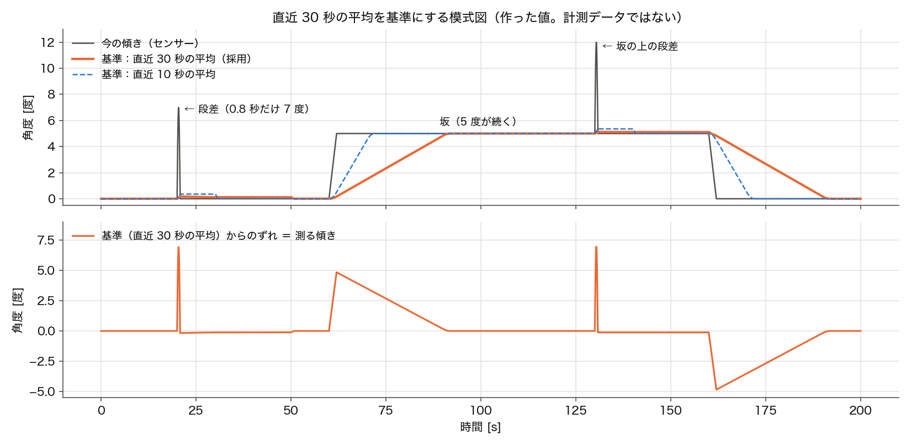
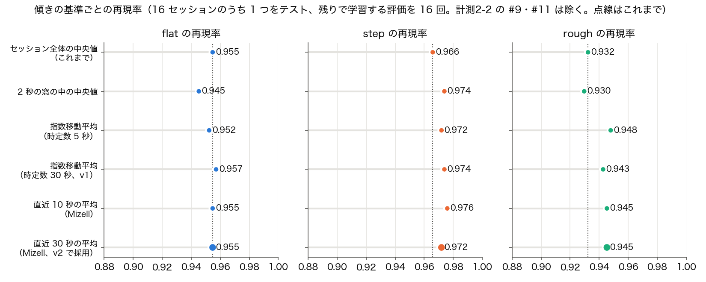
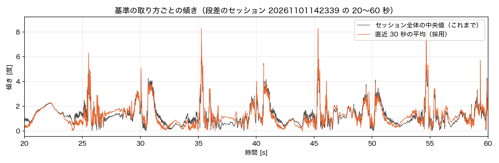
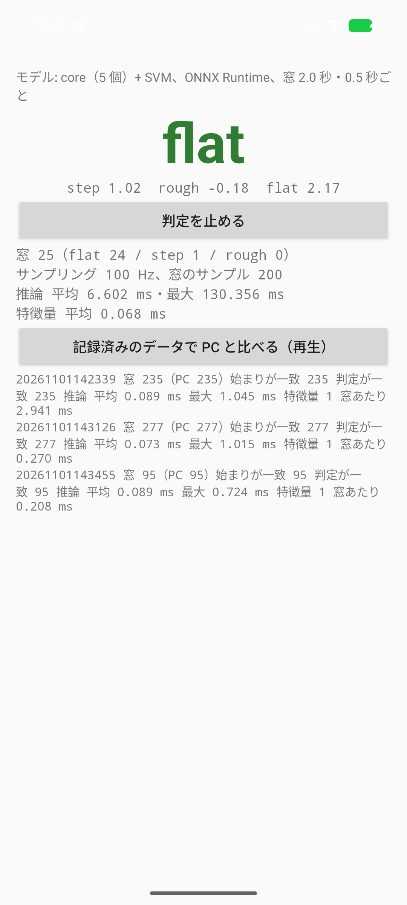

# 判定モデルを ONNX にして、スマホの上（エッジ）で判定する

11.10 の企業 MTG で決めた「（マスト）Android アプリへの移植」の最初の段階。判定モデル（core・SVM・窓 2.0 秒）を ONNX に書き出し、**新しく作った判定用のアプリ**（`apps/detector-android/`）に入れて、PC（Python）と同じ判定を出せるかを確かめた。

- 計測用のアプリ（`MyApplication3`）は、ラベルを付けて記録するためのものなので、そのまま残す。判定用のアプリは別に作る（押しストのアプリにつなげる側）。
- 今回の範囲は「エッジで判定できるか」まで。地図、サーバーへの送信、画面を消したまま動かす仕組みは、まだ作っていない。

## サマリ

- **固定したモデル**：core の 5 個（z_rms・z_kurt・h_std・h_crest・tilt_range）+ StandardScaler + SVM（RBF）。段差のラベルは衝撃の 0.5 秒前から（第 18 回ゼミ）。汎用の車椅子・68〜69 kg の 16 セッション全部で学習した（計測2-2 の #9・#11 は除く。今回から、これを今後の基準にする）。傾きの基準は直近 30 秒の平均（mean30）。ONNX のモデルは **11 KB**（サポートベクター 267 個）。アプリに入れた版は `v2_20261117`。
- **傾きの基準を、スマホで計算できる形に変えた**：これまでの「セッション全体の中央値」は、走り終わらないと決まらない。代わりに、スマホのゆっくり変わる向きを推定する主流の方法（Mizell 2003 の「一定時間の窓の平均」。[Hemminki ら 2013](https://dl.acm.org/doi/10.1145/2517351.2517367) で窓 30 秒が一番よかった）をそのまま使い、「**直近 30 秒の上向きの平均**」を暫定で基準にした。再現率（16 セッションのうち 1 つをテスト、残りで学習する評価。計測2-2 の #9・#11 は除く）は flat / step / rough = 0.955 / 0.966 / 0.932 → **0.955 / 0.972 / 0.945** で、落ちていない（1 章）。
- **変換と組み込み**：scikit-learn で学習したモデル（StandardScaler + SVM）を、**skl2onnx** で ONNX 形式のファイル（`core_svm.onnx`）に変換し、Android アプリに入れて **ONNX Runtime（Android 版）** で動かした。特徴量の計算は ONNX に入らないので、Kotlin で書き直した（2 章）。
- **PC とスマホで判定が一致した**（3 章）。
  - PC の上で、scikit-learn と ONNX Runtime：16 セッションの全部の窓 **3,301 窓で一致**。
  - アプリの実装（Kotlin の特徴量 + ONNX Runtime）を PC の JVM で動かした場合：**3,301 窓で一致**。特徴量の差は、相対誤差で 6×10⁻¹² 以下（tilt_range だけは最大 1.2×10⁻⁶ 度。丸めの差）。
  - Android のエミュレーター（arm64、Android 17、ONNX Runtime Android 1.32.0）で記録済みの 3 セッションを流した場合：**607 窓で一致**。センサーから受け取って判定し、記録したサンプルを PC で判定し直した場合も **116 窓で一致**。
- **計算は軽い**：エミュレーターで、推論は 1 窓あたり平均 0.07〜2.9 ms。窓は 0.5 秒ごとなので、走りながら判定するのに十分間に合う（最初の 1 回などに最大 220 ms かかることがある）。
- **まだ確かめていないこと**：実機（計測に使ったスマホ）で走って判定すること。サンプリングのレート（モデルは約 333 Hz で学習。エミュレーターは 100 Hz）。連続で走ったときの判定（4 章）。

## 1. 傾きの基準を、スマホで計算できる形にする

### なぜ変えるか

tilt_range は「窓の中で、車体の傾きがどれだけ変わったか」。傾きは、端末から見た世界の上向きが、**基準の向き**（ふだんの向き）から何度ずれたかで測る（[ジャイロの特徴量](../2026-11-01/20261101_gyro_features.md)）。これまでの基準はセッション全体の中央値で、走り終わってからでないと計算できない。スマホで走りながら判定するには、**それまでのデータだけで決まる基準**が要る。

特徴量そのもの（窓の中の傾きの範囲）は変えず、基準の取り方だけを変える。

### 根拠：先行研究（Mizell 2003、Hemminki ら 2013）

[Hemminki ら（SenSys 2013）](https://dl.acm.org/doi/10.1145/2517351.2517367) は、バス・電車・地下鉄・トラムに乗っている人のスマホの加速度から、乗り物の種類を判定した研究。スマホの向きはばらばらなので、まず**重力の向き（スマホのゆっくり変わる向き）を推定**し、それを除いた水平・鉛直の加速度から特徴量を作っている。論文の 3.2 節（Preprocessing and Gravity Estimation）に、次のことが書かれている（[本文の PDF](https://cse.buffalo.edu/~lusu/cse726/papers/Accelerometer-Based%20Transportation%20Mode%20Detection%20on%20Smartphones.pdf) で確認）。

- **重力の推定は、「一定時間の窓の平均」が主流**で、Mizell（2003）が最初に提案した（"the dominant approach for estimating the gravity component ... is to use the mean over a window of fixed duration"）。
- その弱点は 2 つ。①加速が続くと推定がずれる。②**スマホの向きが急に変わると、正しい推定に戻るまで大きく遅れる**。窓を短くすると遅れは減るが、推定が今の値を追いすぎて、精度が落ちる。
- 乗り物の中での実験（約 7 時間）で、Mizell の方法の窓を 1・10・30 秒と変えて比べると、4 種類の乗り物すべてで **30 秒が一番よかった**（論文の表 1。GPS の速さとの相関。Hemminki ら自身の方法はさらに上）。

**今回のケースとの対応**

| | Hemminki ら（Mizell の方法） | 今回 |
| --- | --- | --- |
| 推定したいもの（ゆっくり変わる） | 重力の向き（スマホの向き） | ふだんの向き（スマホの付け方、道のゆるい傾き） |
| 取り出したいもの（速く変わる） | 重力を除いた加速度（乗り物の加速・減速） | 基準からのずれ（段差などで一瞬傾いた分） |
| 入力 | 加速度センサーの値 | 姿勢センサー（rotation vector）から計算した、スマホから見た上向き |
| 方法 | 一定時間の窓の平均 | **直近 30 秒の上向きの平均**（そのまま同じ） |
| 窓の長さ | 1・10・30 秒を比べ、30 秒が一番よい | 30 秒（10 秒・30 秒を比べた。下の結果） |
| 弱点 | 向きが急に変わると遅れる | 同じ（坂に入ったとき・出たとき。下の折りたたみ「坂道で使えるか」） |

- 目的（ゆっくり変わる向きを推定して、速い変化を取り出す）も、方法（一定時間の窓の平均）も同じなので、**Mizell の方法を、窓 30 秒でそのまま使う**。違いは、入力が生の加速度ではなく、すでに姿勢センサーで計算された向きであること。
- 窓は、走りながら計算するので「今から 30 秒前まで」（過去の 30 秒）にする。
- 段差の傾きは最大でも 0.81 秒しか続かない（[段差を通るときの車体の傾き](../2026-11-08/20261108_step_tilt.md)）。30 秒の平均の中では 3% 足らずなので、段差の傾きで基準はほとんど動かない。

Mizell（2003、ISWC）の本文は読めていない。方法の中身は、Hemminki らの説明による。

<details>
<summary>くわしく：直近 30 秒の平均とは（具体例）</summary>

新しいセンサーの値が来るたびに、**今から 30 秒前までの向きを全部平均したもの**を基準にする。それと今の向きとの差が、測る傾き。

- 平らな道を走っていれば、基準は「平らな道でのふだんの向き」になる。
- 段差で 0.8 秒だけ 7 度傾いても、30 秒分の平均の中では 0.8 秒分しか入らないので、基準は 0.1 度くらいしか動かない。段差の傾きは、ほぼ 7 度のまま測れる。
- 坂に入って 5 度の傾きがずっと続くと、基準は 30 秒かけて、まっすぐ 5 度まで近づく（15 秒後に約半分、30 秒後に 5 度）。30 秒たてば、坂の上を「ふだんの向き」として扱う。
- 自分で決めるのは「何秒分を平均するか」（30 秒）だけ。ほかはセンサーの値から決まる。
- 30 秒分（約 1 万サンプル）の向きを覚えておく必要があるが、合計を足し引きするだけなので、スマホの計算は軽い（アプリで 1 窓あたり 1 ms 未満〜数 ms）。

</details>



模式図（作った値。計測データではない）。段差（20 秒）では基準はほとんど動かないので、段差の傾き（約 7 度）をそのまま測れる。坂（60〜160 秒）では、基準が 30 秒かけて坂の傾きに追いつく。坂を出たあと（160 秒〜）も、30 秒かけて元に戻る。

<details>
<summary>くわしく：模式図の読み方</summary>

作った値で、平らな道 → 段差 → 坂（5 度が 100 秒続く）→ 坂の上で段差 → 平らな道、を走った場合。上の図が今の傾きと基準、下の図が基準（直近 30 秒の平均）からのずれ（＝測る傾き）。

- **段差（20 秒）**：傾きは 0.8 秒だけ 7 度になるが、基準は 0.09 度しか動かない。ずれは約 6.9 度で、段差の傾きをそのまま測れる。
- **坂（60〜160 秒）**：基準は 30 秒かけて 5 度に追いつく（約 92 秒で追いつく）。坂に入った直後は、ずれが約 5 度になり、30 秒かけて 0 に戻る。10 秒の平均なら 10 秒で追いつく。
- **坂の上の段差（130 秒）**：基準が坂に追いついているので、ずれは約 6.9 度で、平らな道の段差と同じに見える。
- **坂を出たあと（160 秒〜）**：今度は基準が元に戻るまで、30 秒ずれが残る。

</details>

<details>
<summary>坂道で使えるか（未確認）</summary>

これまでの 16 セッションに坂道のデータは無く、確かめていない。理屈の上では次のように考えている。

- **坂の途中（同じ勾配が続く部分）**：tilt_range は「2 秒の窓の中で傾きがどれだけ変わったか」なので、勾配が一定なら小さい。基準も 30 秒で坂の向きに追いつく。これまでの「セッション全体の中央値」は、途中で坂に入るとずれたままになるので、それよりは坂に強いはず。
- **坂の入り口・出口**：傾きが短い時間で数度変わるので（模式図の 60 秒・160 秒）、段差と似た動きになり、step と間違える可能性がある。これは基準の取り方ではなく、tilt_range という特徴量そのものの性質。
- **入ったあと・出たあとの 30 秒**：基準がまだ追いついていないので、ほかの姿勢の変化が大きく見えることがある。Hemminki らの言う「向きが急に変わると遅れる」弱点と同じ。
- **セッションの最初**：最初の 30 秒は、それまでのデータだけの平均になる。tilt_range は 2 秒の窓の中の変化なので、影響は小さいと考えている（最初だけを分けては確かめていない）。
- 12 月に、坂道の上り・下りを測って確かめる（[段差を通るときの車体の傾き](../2026-11-08/20261108_step_tilt.md) の 5 章の計画）。

</details>

### 比べた基準と結果

| 基準 | 中身 | スマホで計算できるか |
| --- | --- | --- |
| session | セッション全体の中央値（これまで） | できない |
| window | 2 秒の窓の中の中央値 | できる |
| ema5・ema30 | 指数移動平均（時定数 5・30 秒。v1 で使っていた） | できる |
| mean10・**mean30** | **直近 10・30 秒の平均（Mizell の方法）** | できる |

条件は第 18 回ゼミの「前 0.5 秒」と同じ（汎用・68〜69 kg の 16 セッション、方針A、core、SVM、窓 2.0 秒）。session は、これまでのパイプラインと特徴量が完全に一致することを確かめた（相対誤差 0）。

**計測2-2 の #9・#11 は除く**（今回から、これを今後の基準にする）：凸凹のセッション 計測2-2（`20261101143126`）の通過 #9・#11 は、STOP が揺れの終わりから 4.58・3.20 秒遅れ、区間の後半に揺れの無い走行が入っていた（[セッション 143126 の確認](../2026-11-07/20261107_session_143126_check.md)、第 18 回ゼミ）。この 2 回を、取り消した通過と同じ扱いにして、区間に重なる窓を学習・評価の両方から除く（`configs/sessions/excluded_passes.csv`）。除いた窓は rough の 24 窓（1,746 → 1,722 窓）。

- 注意：#9・#11 は、間違いの多い通過を見てから選んだもの（理由は STOP の遅れで、波形でも確かめている）。除いた精度は、そのぶん少し楽観的。
- 参考に、除かない場合（第 18 回の「そのまま」）の結果も下に書く。

**評価のしかた（セッション単位の交差検証、LOGO：Leave-One-Group-Out）**：16 セッションのうち 1 セッションをテストに回し、残りの 15 セッションで学習して、テストのセッションの窓を判定する。これを、テストに回すセッションを替えながら 16 回くり返し、全部の窓の判定から再現率を出す。同じセッションの窓が学習とテストの両方に入らないので、「学習で見ていない走行」に対する精度になる。これまでのゼミの数値も、すべてこの評価。



| 基準 | flat / step / rough | step ↔ rough | flat → 段差・凸凹 | tilt_range の中央値（flat / step / rough） |
| --- | --- | --- | --- | --- |
| session（これまで） | 0.955 / 0.966 / 0.932 | 13 + 17 = 30 | 38 | 1.23 / 7.24 / 3.01 度 |
| window | 0.945 / 0.974 / 0.930 | 9 + 21 = 30 | 46 | 1.01 / 6.98 / 2.54 度 |
| ema5 | 0.952 / 0.972 / 0.948 | 10 + 13 = 23 | 40 | 1.24 / 6.68 / 2.81 度 |
| ema30（v1） | 0.957 / 0.974 / 0.943 | 9 + 14 = 23 | 36 | 1.22 / 6.96 / 3.04 度 |
| mean10 | 0.955 / 0.976 / 0.945 | 8 + 15 = 23 | 38 | 1.28 / 6.73 / 2.92 度 |
| **mean30（v2 で採用）** | **0.955 / 0.972 / 0.945** | **10 + 13 = 23** | 38 | 1.17 / 6.92 / 2.97 度 |

（#9・#11 を除いた 1,722 窓。「step ↔ rough」は step → rough ＋ rough → step の窓の数）

- mean30 は、session と比べて step・rough が上がり（0.966 → 0.972、0.932 → 0.945）、flat は同じ（0.955）。step ↔ rough の取り違えは 30 → 23 窓。
- 過去の平均・指数移動平均（ema5・ema30・mean10・mean30）の差は小さい（0.006 以内）。今回のデータでは、10 秒と 30 秒の差は step の 0.004（10 秒がわずかに上）だけで、どちらがよいとは言えない。30 秒にしたのは、Hemminki らの乗り物での実験で 30 秒が一番よかったことに合わせたため。

参考：#9・#11 を除かない場合（1,746 窓。第 18 回の「そのまま」と同じ条件）

| 基準 | flat / step / rough | step ↔ rough |
| --- | --- | --- |
| session（これまで） | 0.956 / 0.968 / 0.909 | 15 + 22 = 37 |
| ema30（v1） | 0.958 / 0.976 / 0.917 | 11 + 19 = 30 |
| mean30 | 0.955 / 0.976 / 0.922 | 11 + 18 = 29 |

- session の「そのまま」は、第 18 回ゼミの「前 0.5 秒」（0.96 / 0.97 / 0.91、取り違え 37 窓）と同じ。第 18 回の「#9・#11 を除く」の行（0.96 / 0.95 / 0.93）は、段差のラベルが START＋1 秒からなので、上の表の session（0.955 / 0.966 / 0.932）とは段差の値が違う。



### 判断：mean30（直近 30 秒の平均）を暫定で使う

- **根拠**：Hemminki ら（2013）が、スマホのゆっくり変わる向きの推定の主流として挙げている Mizell の方法（一定時間の窓の平均）と、目的・方法が同じ。窓の長さも、乗り物での実験で一番よかった 30 秒にそろえた。
- **結果**：これまでの「セッション全体の中央値」と比べて、精度は落ちない（#9・#11 を除いた条件で、flat / step / rough = 0.955 / 0.966 / 0.932 → 0.955 / 0.972 / 0.945）。
- **スマホで計算できる**：それまでのサンプルだけで決まる。
- 以上から、判定モデル `v2_20261117` では mean30 を**暫定で**使う（v1 の ema30 から切り替えた）。

暫定とした理由（残っている課題）：

- **窓 30 秒は、乗り物（バス・電車など）の実験での結果で、車椅子で確かめたものではない**。今回のデータでは 10 秒と 30 秒の差は小さく（10 秒がわずかに上）、この 16 セッションで比べただけ。
- **向きが急に変わると遅れる**（Hemminki らの言う弱点）。坂に入ったとき・出たときの 30 秒は、基準がずれたままになる。坂道のデータで確かめていない。Hemminki らは、向きが大きく変わったら推定をやり直す工夫をしている。必要なら同じ工夫を足せる。
- window（2 秒の窓の中の中央値）が flat で下がるのは、窓の中央値が、その窓の揺れそのものに引っぱられるためと考えられる（未検証）。

参考：同じ「ゆっくり変わる成分を低域フィルタで取り出す」考え方は、[Android の公式ドキュメント（SensorEvent）](https://developer.android.com/reference/android/hardware/SensorEvent)（重力を取り出すサンプルコード）や、[Anguita ら 2013](https://www.esann.org/sites/default/files/proceedings/legacy/es2013-84.pdf)（加速度を 0.3 Hz の低域フィルタで体の動きと重力に分ける）にもある。[W3C の Motion Sensors Explainer](https://www.w3.org/TR/motion-sensors/) は、こうしたフィルタには遅れがあると注意している。

## 2. モデルを ONNX に変換して、アプリに組み込む

### 流れ

```
[PC：研究リポジトリ（Python）]
  16 セッションの acc.csv
    → core の特徴量（src/roadml/core_model.py）
    → scikit-learn で学習（StandardScaler + SVC）
    → skl2onnx で ONNX に変換 → core_svm.onnx（11 KB）
                                   │ apps/detector-android/models/v2_20261117/ に置く
                                   ▼
[スマホ：判定用のアプリ（Kotlin）]
  加速度・姿勢のセンサー（約 333 Hz）
    → core の特徴量（CoreFeatureExtractor.kt。Python と同じ手順を Kotlin で書き直した）
    → ONNX Runtime（Android 版）で core_svm.onnx を動かす
    → flat / step / rough
```

### 1. scikit-learn で学習する

- `src/experiments/e20261116_export_onnx.py`。これまでの評価と同じ `make_pipeline(StandardScaler(), SVC(kernel="rbf", C=1.0, gamma="scale", class_weight="balanced"))` を、16 セッションの全部のラベル付きの窓（flat 840・step 498・rough 384。計測2-2 の #9・#11 は除く）で学習し直した。
- 精度の評価は、セッション単位の交差検証（1 章）で済んでいる。書き出す前に、全部のデータで学習し直しただけ。

### 2. skl2onnx で ONNX に変換する

- **ONNX**：機械学習のモデルを保存する共通の形式。学習に使った Python が無い環境（Android など）でも、ONNX Runtime という実行のライブラリでモデルを動かせる。
- **skl2onnx**（1.20.0）：scikit-learn のモデルを ONNX に変換するライブラリ。次のように変換した。

  ```python
  from skl2onnx import to_onnx
  from skl2onnx.common.data_types import FloatTensorType

  onx = to_onnx(model,  # 学習済みの Pipeline(StandardScaler, SVC)
                initial_types=[("features", FloatTensorType([None, 5]))],  # 入力: 5 個の特徴量
                options={id(svc): {"zipmap": False}},  # 出力を、辞書ではなく配列にする
                target_opset={"": 17, "ai.onnx.ml": 3})
  ```

- 変換した中身：`Scaler`（標準化）→ `SVMClassifier`（SVM）→ scikit-learn の `decision_function` と同じ ovr の値に直す計算。StandardScaler の平均・標準偏差と、SVM のサポートベクター（267 個）・係数が、ファイルの中に数値として入る。
- 入力は `features`（float32、[窓の数, 5]）。特徴量の順番は z_rms・z_kurt・h_std・h_crest・tilt_range。出力は `label`（判定）と `probabilities`（各クラスの値。名前は probabilities だが、確率ではなく SVM の決定関数の値）。
- 変換した直後に、PC の onnxruntime（1.32.0）で読み込み、scikit-learn と同じ判定になるかを確かめた（3 章の 1）。

### 3. アプリに組み込む

- **新しい判定用のアプリ**（`apps/detector-android/`、Kotlin）を作った。計測用のアプリ（`MyApplication3`）は変えていない。
- **モデルの置き場所**：`apps/detector-android/models/v2_20261117/`（`core_svm.onnx` と、学習の条件を書いた `model_info.json`）。モデルを改良したときのため、版ごとのフォルダにした。使う版は `gradle.properties` の `roaddetector.modelVersion` で選び、ビルドのときにアプリのアセットに入る（`models/README.md`）。
- **ONNX Runtime**：Android 版のライブラリ `com.microsoft.onnxruntime:onnxruntime-android:1.32.0`（PC の Python と同じ版）を使う。`OnnxClassifier.kt` で、アセットの `core_svm.onnx` を読み込んで判定する。
- **特徴量は Kotlin で書き直した**：ONNX に入るのはモデル（標準化と SVM）だけで、加速度から特徴量を作る部分は入らない。`CoreFeatureExtractor.kt` で、Python の基準の実装（`src/roadml/core_model.py`）と同じ手順にした。センサーのサンプルを 1 つずつ受け取り、2.0 秒の窓が出そろうたびに（0.5 秒ごとに）特徴量を出す。
- **アプリの動き**（`MainActivity.kt`）：加速度と姿勢（rotation vector）を約 333 Hz で受け取り（計測用のアプリと同じ設定）、0.5 秒ごとに判定して画面に出す。判定に使ったサンプルを `input.csv`、窓ごとの特徴量・判定・計算時間を `judge.csv` に残す。



## 3. スマホと PC で同じ判定になるか

### どう確かめたか

アプリの判定が PC（Python）と同じになるかを、次の 4 段階で確かめた。どれも、**同じ入力のデータに対して、窓ごとの判定が PC と同じか**を比べている（路面の正解に対する精度ではない）。

| # | どこで動かしたか | 入力のデータ | 比べる相手 |
| --- | --- | --- | --- |
| 1 | PC：onnxruntime（Python） | 16 セッションの全部の窓の特徴量 | scikit-learn の判定 |
| 2 | PC：アプリの Kotlin のコード + ONNX Runtime（JVM の単体テスト `ParityTest.kt`） | 16 セッションの acc.csv（研究リポジトリの wheelchair_data をそのまま読む） | PC（Python）の特徴量と判定 |
| 3 | Android のエミュレーター：アプリの「再生」 | **アプリに入れておいた CSV**（3 セッション） | PC の判定（アプリに一緒に入れておく） |
| 4 | Android のエミュレーター：センサーから判定 | エミュレーターの仮想センサー（60 秒） | 記録した `input.csv` を PC で判定し直した結果 |

**3 の「再生」の中身**：本来は、スマホがその場で取得した加速度に対して判定する。しかし、その場で取得したデータには PC の正解が無く、同じ入力で比べられない。そこで今回は、**計測用のアプリで取得済みの CSV を前もってアプリに埋め込み、センサーの代わりに CSV の値を流して判定させた**。センサーから取得した加速度での確認は 4（エミュレーター）で行い、実機では 5 章の手順で行う。

- 入力：段差・凸凹・flat から 1 セッションずつ（`20261101142339`・`20261101143126`・`20261101143455`）。acc.csv から、判定に使う列（時刻・加速度・姿勢）だけを取り出して圧縮し（計 2.8 MB）、デバッグ版のアプリにだけ入れた（`app/src/debug/assets/replay/`）。値は書き換えていない。
- 正解：同じ 3 セッションの、PC での窓ごとの判定（`models/v2_20261117/replay/`）。
- アプリは CSV を 1 行ずつ読み、**センサーから受け取るときと同じ処理**（`CoreFeatureExtractor.push`）に流して、Android 版の ONNX Runtime で判定する。窓ごとに、窓の始まりの時刻と判定を正解と比べ、一致した数を画面と logcat に出す。
- 画面のボタン、または `adb shell am start -n com.example.roaddetector/.MainActivity --ez replay true` で動かす。
- この 3 セッションは学習にも使っているので、精度の評価ではなく、**PC と同じ計算になっているかの確認**。

**4 のセンサーからの判定**：エミュレーターで 60 秒判定し、記録（`input.csv`・`judge.csv`）を adb で PC に取り出して、`src/experiments/e20261116_check_device_session.py` で判定し直した。センサーを受け取ってから判定するまでの流れが、PC と同じ計算になっているかの確認。

### 結果

| # | 窓 | 判定の一致 | 特徴量・値の差 |
| --- | --- | --- | --- |
| 1 | 3,301（16 セッションの全部の窓） | **3,301** | 決定関数の値の差 最大 1.2×10⁻⁶ |
| 2 | 3,301 | **3,301** | 相対誤差 6×10⁻¹² 以下。tilt_range だけ最大 1.2×10⁻⁶ 度 |
| 3 | 607（235・277・95） | **607** | 窓の始まりの時刻も全部一致 |
| 4 | 116 | **116** | 最大 5.4×10⁻⁶（端末の float を CSV に書いて読み直す丸め） |

- 「全部の窓」は、ラベルの区間の外の窓も含む。アプリは、ラベルに関係なく全部の窓を判定するため。
- tilt_range の差（最大 1.2×10⁻⁶ 度）は、arccos の丸め。内積が 1 の 1 つ手前の数に丸まると、角度は arccos(1 − 1.1×10⁻¹⁶) = 8.5×10⁻⁷ 度になり、差はこの倍数になっていた。判定には効かない。
- 3・4 のエミュレーターは、このパソコンの AVD（Pixel_7、arm64-v8a、Android 17）を、AVD の中身を書き換えない設定（`-read-only`）で動かした。実機ではまだ確かめていない（5 章）。

### 計算時間・大きさ

| 項目 | 値 |
| --- | --- |
| ONNX のモデル | 11 KB |
| 推論（PC、onnxruntime） | 1 窓 0.014 ms |
| 推論（PC の JVM、Kotlin） | 1 窓 0.032 ms |
| 推論（エミュレーター） | 1 窓 平均 0.07〜2.9 ms。最大 220 ms（最初の 1 回など） |
| 特徴量（エミュレーター） | 1 窓あたり 0.1〜4 ms |
| APK（デバッグ版） | 41 MB（ONNX Runtime を arm64 だけにした。全部入りは 150 MB） |

窓は 0.5 秒ごとに 1 つなので、計算は十分に間に合う。

## 4. 気をつけること・まだ確かめていないこと

- **実機で確かめていない**。エミュレーターの仮想センサーは 100 Hz で、値もほぼ一定。計測に使ったスマホに入れて、実際に車椅子で走って確かめる必要がある。手順は 5 章。
- **サンプリングのレートに依存する**。モデルは約 333 Hz（3 ms 間隔）のデータで学習した。尖度やクレストは、レートが変わると値が変わりうる。違う機種で使うときは、画面に出るレートを見て、約 333 Hz かどうかを確かめる。
- **エミュレーターの仮想センサーは値がほぼ一定**（加速度のばらつき 10⁻¹⁵）。z の分散がほぼ 0 なので、尖度が計算の誤差だけで決まる。v1 のモデルでは、静止したまま 116 窓のうち 1 窓が step になった（v2 では 0 窓）。実際のセンサーにはノイズがあるので、実機では起きないと考えている（未確認）。
- **連続で走ったときの判定は、まだ評価していない**。これまでの評価（方針A）は、ラベルの区間の中の窓だけを使い、区間の外の窓は学習にも評価にも入れていない。今のデータでは、区間の外は同じ段差・凸凹を往復するときの切り返しや一時停止で、実際の走行の平らな道とは違う。そのため、区間の外の窓の判定（段差・凸凹のセッションで、どの通過にも重ならない 485 窓のうち、flat は約 21%。v2 のモデル）を、実際に使ったときの誤検知とは見なせない。12 月に、段差・凸凹の位置が分かっているコースを連続で走り、区間に入る前の平らな直線で flat になるか、区間で検出できるか、止まる・曲がる場面でどうなるかを分けて測る。
- **学習データの幅**：68〜69 kg の 1 人と、汎用の車椅子だけで学習している。体重・車椅子の違いは、今年は扱わない（11.10 の MTG）。
- **ONNX の出力の「値」は確率ではない**。SVM の決定関数の値（ovr）で、大きいクラスが判定になる。

## 5. 実機での確かめ方

1. `apps/detector-android` を Android Studio で開き、計測に使ったスマホに入れる（またはこのフォルダで `./gradlew :app:installDebug`）。
2. 「記録済みのデータで PC と比べる（再生）」を押す。3 セッションの「判定が一致」が窓の数と同じなら、実機の ONNX Runtime でも PC と同じ判定になっている。
3. 「判定を始める」を押して、段差・凸凹・平らな道を走る。画面に判定・サンプリングのレート・推論の時間が出る。
4. 走った後、記録を PC に取り出して判定し直す。

   ```sh
   adb pull /sdcard/Android/data/com.example.roaddetector/files/sessions/<日時> data/analysis/20261116_device_sessions/
   uv run python -m src.experiments.e20261116_check_device_session data/analysis/20261116_device_sessions/<日時>
   ```

## 6. 次にやること

1. 実機で 5 章を行う（レート、判定の一致、走ったときの判定の様子）。
2. 判定に GPS を付けて残す。その後、サーバーへの送信と地図（Web ビュー）につなぐ（12.11 の定例までに）。
3. 画面を消しても判定を続けられるようにする（フォアグラウンドサービス）。
4. 段差・凸凹の位置が分かっているコースを連続で走り、検出率・誤検知・位置のずれを測る（4 章）。

## 再現のしかた

```sh
uv run python -m src.experiments.e20261116_tilt_reference      # 1 章
uv run python -m src.experiments.e20261116_export_onnx --version v2_20261117 --tilt-ref mean30  # 2 章（変換）・3 章の 1
uv run python -m src.experiments.e20261116_make_replay_assets --version v2_20261117      # 3 章の 3（再生用のデータ）
(cd apps/detector-android && ./gradlew :app:testDebugUnitTest) # 3 章の 2
uv run python -m src.experiments.e20261116_plots               # 図
```

モデルは `apps/detector-android/models/<版>/` に書き出す。それ以外の出力は `data/analysis/20261116_*`（Git の管理外）。
